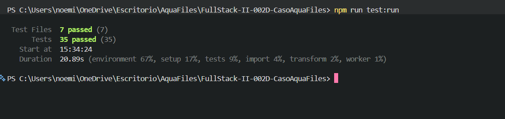

# AquaFiles

**Plataforma para centralizar la gestión de candidatos y evaluaciones psicolaborales de AquaChile.**

 **Demo publicada:** [AquaFiles en Vercel](https://full-stack-ii-002-d-caso-aqua-files.vercel.app/)

```text
Postulante → Analista de Reclutamiento → Filtro técnico → Derivación al evaluador → Evaluación psicolaboral → Resultado
```

---

## Objetivo

Hoy el proceso de selección se apoya en planillas Excel, Planner y archivos repartidos en distintos lugares. **AquaFiles** reemplaza esas herramientas por una sola vista centralizada, donde se puede:

- Recibir postulaciones con un formulario estandarizado y el CV adjunto.
- Consultar los antecedentes de cada candidato en un expediente digital.
- Actualizar el estado de cada candidato a lo largo del proceso.
- Derivar al psicólogo los perfiles aprobados técnicamente, con su dossier.
- Seguir el avance del proceso con indicadores.

---

## Requerimientos del caso cubiertos

| Requerimiento | Cómo se cumple |
| :--- | :--- |
| RF01 Ingreso con roles simulados | El postulante entra sin cuenta. El analista y el evaluador inician sesión con usuario y contraseña de prueba |
| RF02 Registrar candidatos | Formulario con nombre, RUT, correo, teléfono, cargo, familia, ubicación, centro de costos y CV |
| RF03 Editar y consultar candidato | Ficha del analista con "Editar datos" |
| RF04 Crear solicitudes | Botón "Nueva solicitud" en el panel del analista |
| RF05 Cargo, familia, fecha y responsable | Fecha de solicitud automática; el Dashboard muestra fecha y responsable de cada solicitud |
| RF06 Listado y detalle | Tabla de solicitudes y ficha del candidato |
| RF07 Buscar y filtrar | Búsqueda por texto y filtros por estado y centro de costos |
| RF08 Estados | Pendiente → En proceso → Finalizada (columna "Etapa" del dashboard) |
| RF09 Evaluación | Fecha de entrevista, resultado y observaciones del evaluador |
| RF10 Dashboard | Página Dashboard del analista con indicadores y etapa de cada solicitud |

> Todos los datos son **ficticios**. No se usan nombres, RUT, teléfonos ni correos reales.

---

## Roles y permisos

> 🔒 **Acceso por rol:** el postulante entra sin cuenta y solo ve su formulario y el estado general de su postulación ("En revisión técnica", "Agendado", "Proceso finalizado"). El personal de AquaChile (analista y evaluador) debe **iniciar sesión**. Si alguien abre una pantalla interna sin sesión, ve "Acceso restringido".

**Usuarios de prueba (ficticios):**

| Usuario | Contraseña | Nombre | Rol |
| :--- | :--- | :--- | :--- |
| `analista` | `aqua123` | Rosa Martínez | Analista de Reclutamiento |
| `evaluador` | `aqua123` | Luis Herrera | Profesional Evaluador |

> Como todavía no hay backend, el inicio de sesión es **simulado**: los usuarios están en `src/data/usuarios.js` y la sesión se pierde al recargar la página. En el Hito 2 se validará en el servidor.

### Postulante / Candidato

- Registrar sus datos (nombre, RUT, correo, teléfono, cargo, familia, ubicación y centro de costos) y adjuntar su CV.
- Consultar el estado de su postulación con su RUT.

**No puede:** ver otros candidatos, decisiones internas, observaciones ni el dashboard.

### Analista de Reclutamiento

- Registrar candidatos y crear solicitudes ("Nueva solicitud").
- Buscar y filtrar por texto, estado y centro de costos.
- Editar datos del candidato y escribir observaciones técnicas.
- Aprobar o rechazar la etapa técnica.
- Derivar al evaluador a los candidatos aprobados.
- Revisar el Dashboard con los indicadores del proceso.

**No puede:** redactar ni modificar la evaluación psicolaboral.

### Profesional Evaluador

- Ver solo las solicitudes derivadas.
- Agendar la entrevista y leer las observaciones del analista.
- Registrar el resultado y las observaciones de la evaluación.
- Subir el informe final y cerrar el proceso.

**No puede:** modificar la calificación técnica ni eliminar candidatos.

---

## Pantallas

| # | Pantalla | Usuario | Qué permite hacer |
| :---: | :--- | :--- | :--- |
| 1 | **Inicio** | Todos | Entrar como postulante o ir al inicio de sesión del personal |
| 2 | **Inicio de sesión** | Analista y evaluador | Ingresar con usuario y contraseña |
| 3 | **Mi postulación** | Postulante | Postular con el formulario o consultar su estado con el RUT |
| 4 | **Panel de Reclutamiento** | Analista | Tabla, filtros, nueva solicitud, ficha, edición, aprobación, rechazo y derivación |
| 5 | **Dashboard** | Analista | Indicadores Pendientes / En proceso / Finalizadas, resumen por familia de cargo y etapa de cada solicitud |
| 6 | **Panel de Evaluaciones** | Evaluador | Solicitudes derivadas, entrevista, resultado e informe |
| 7 | **Acceso restringido / 404** | Todos | Aviso cuando la ruta no corresponde al rol o no existe |

### Funcionalidades

| Funcionalidad | Reemplaza a | Prioridad | En la demo actual |
| :--- | :--- | :---: | :---: |
| Formulario de postulación con validaciones y CV | Recepción de CV por correo | Alta | ✅ Disponible |
| Registro de candidatos y solicitudes por el analista | Planillas Excel | Alta | ✅ Disponible |
| Tabla con búsqueda y filtros por estado y centro de costos | Planillas Excel | Alta | ✅ Disponible |
| Edición de datos y observaciones técnicas | Correcciones manuales | Alta | ✅ Disponible |
| Aprobación, rechazo y derivación al evaluador | Tareas en Planner | Alta | ✅ Disponible |
| Resultado e informe de la evaluación | Envío del informe por correo | Alta | ✅ Disponible |
| Consulta de postulación por RUT | Consultas por correo | Media | ✅ Disponible |
| Dashboard con indicadores | Cálculos manuales | Media | ✅ Disponible |
| Asignar un profesional responsable al derivar | Coordinación por correo | Media | 🔜 Próxima etapa |
| Persistencia en base de datos | — | Alta | 🔜 Hito 2 (backend) |

---

## Flujo principal

1. El postulante (o el analista con `Nueva solicitud`) registra los datos y el CV. La solicitud queda `En revisión técnica`.
2. El analista revisa la ficha, corrige datos si hace falta y escribe observaciones técnicas.
3. El analista aprueba (`Aprobado técnicamente`) o rechaza (`Rechazado técnicamente`).
4. Si aprueba, presiona `Derivar al evaluador` y el estado pasa a `Derivado a psicólogo`.
5. El evaluador agenda la entrevista (`Agendado`) y registra el resultado y sus observaciones.
6. El evaluador sube el informe y el proceso queda `Proceso Finalizado`.
7. El dashboard y el seguimiento del postulante se actualizan.

**Estados del candidato:**

```text
En revisión técnica ──→ Rechazado técnicamente
        ↓
Aprobado técnicamente
        ↓
Derivado a psicólogo
        ↓
Agendado
        ↓
Proceso Finalizado
```

### Diagrama de flujo

El diagrama muestra el proceso completo del MVP.

```mermaid
flowchart TD
    INI(["Inicio"]) --> A1

    subgraph P1["1. Portal del Postulante"]
        A1["Candidato ingresa a la plataforma web"] --> A2["Completa formulario estandarizado"]
        A2 --> A3["Adjunta Curriculum Vitae (PDF/Word)"]
        A3 --> A4["Envía postulación<br/>Estado: En revisión técnica"]
        N1["- Datos personales<br/>- Familia de cargo<br/>- Ubicación / Planta<br/>- Cargo al que postula"]
        A2 -.- N1
    end

    subgraph P2["2. Panel de Reclutamiento (Analista de Reclutamiento)"]
        B1["Analista de Reclutamiento visualiza el registro en la tabla general"] --> B2["Abre la ficha técnica y dossier del postulante"]
        B2 --> D1{"¿Se requiere editar o corregir datos?"}
        D1 -- Sí --> B3["Modificar información (Cargo, Ubicación, CC)"]
        B3 --> B4
        D1 -- No --> B4["Evalúa requisitos técnicos y antecedentes del candidato"]
        B4 --> D2{"¿Aprueba la evaluación técnica?"}
        D2 -- No --> B5["Estado: Rechazado técnicamente"]
        B5 --> B6["Archivar postulación"]
        B6 --> FIN1(["Fin"])
        D2 -- Sí --> B7["Estado: Aprobado técnicamente"]
        B7 --> B8["Genera el dossier técnico del candidato"]
        B8 --> B9["Derivar al evaluador"]
    end

    subgraph P3["3. Evaluación Psicolaboral"]
        C1["Profesional Evaluador recibe el dossier con CV y datos"] --> C2["Agenda entrevista psicológica vía Teams<br/>Estado: Agendado"]
        C2 --> C3["Realiza entrevista y toma de notas"]
        C3 --> C4["Elabora informe psicolaboral (con apoyo de Copilot)"]
        C4 --> C5["Sube el informe psicolaboral final a la plataforma"]
        C5 --> C6["Estado: Proceso Finalizado"]
    end

    subgraph P4["4. Centralización & Dashboard (KPIs)"]
        E1["Sistema actualiza el pipeline general de candidatos"] --> E2["Consolida indicadores de gestión"]
        E2 --> E3["Proceso finalizado exitosamente"]
        N2["- Candidatos por estado<br/>- Timing promedio (solicitud vs. informe)<br/>- Volúmenes por familia de cargo y ubicación"]
        E2 -.- N2
    end

    A4 --> B1
    B9 --> C1
    C6 --> E1
    E3 --> FIN2(["Fin"])

    classDef actividad fill:#F4F6F9,stroke:#1E3A8A,color:#0F172A;
    classDef decision fill:#FEF3C7,stroke:#D97706,color:#0F172A;
    classDef nota fill:#EFF6FF,stroke:#3B82F6,color:#0F172A;
    classDef limite fill:#1E3A8A,stroke:#1E3A8A,color:#FFFFFF;

    class A1,A2,A3,A4,B1,B2,B3,B4,B5,B6,B7,B8,B9,C1,C2,C3,C4,C5,C6,E1,E2,E3 actividad;
    class D1,D2 decision;
    class N1,N2 nota;
    class INI,FIN1,FIN2 limite;

    style P1 fill:#F1F5F9,stroke:#94A3B8,color:#1E293B
    style P2 fill:#F1F5F9,stroke:#94A3B8,color:#1E293B
    style P3 fill:#F1F5F9,stroke:#94A3B8,color:#1E293B
    style P4 fill:#F1F5F9,stroke:#94A3B8,color:#1E293B
    linkStyle default stroke:#2563EB
```



> El análisis completo de roles, interfaces y flujo (incluido el diagrama original en PlantUML) está en [`docs/Actividad_Bases_MVP_AquaChile_DSY1104.md`](docs/Actividad_Bases_MVP_AquaChile_DSY1104.md) (también disponible en [PDF](docs/Actividad_Bases_MVP_AquaChile_DSY1104.pdf)).

---

## Cómo probar el MVP

Puede usar la [demo publicada](https://full-stack-ii-002-d-caso-aqua-files.vercel.app/) o ejecutarla localmente (ver [Información técnica](#información-técnica)).

**Como Analista de Reclutamiento:**

1. En el inicio, elegir `Personal AquaChile` e iniciar sesión con `analista` / `aqua123`.
2. Presionar `Nueva solicitud`, completar el formulario y `Registrar solicitud`.
3. Elegir a Pedro Soto y presionar `Derivar al evaluador`.
4. Abrir `Dashboard` en el menú para ver los indicadores.

**Como Profesional Evaluador:**

5. `Cerrar sesión` → `Personal AquaChile` → `evaluador` / `aqua123`.
6. Elegir a Pedro Soto, indicar la fecha de entrevista, elegir el resultado y `Guardar evaluación`.

**Como Postulante:**

7. `Cerrar sesión` → `Postulante / Candidato`.
8. Consultar con el RUT `20.456.789-1`: se ve "En revisión técnica", sin información interna.
9. Escribir `/supervisor` en la barra de direcciones: aparece "Acceso restringido".

---

## Preguntas abiertas

Puntos que necesitamos confirmar con AquaChile para las próximas etapas:

1. ¿Qué ve el postulante si queda fuera del proceso?
2. ¿Teams y Copilot se conectan a la plataforma o se usan por fuera?
3. ¿El sistema debe enviar correos automáticos?
4. ¿Cómo se mide exactamente el tiempo del proceso?
5. ¿Hasta qué momento el analista puede corregir datos?
6. ¿El candidato puede cambiar su CV si se equivocó?

---

## Estado del proyecto

AquaFiles es actualmente un **MVP frontend**. Los datos y los roles están simulados para mostrar el flujo completo. Todavía no tiene inicio de sesión real ni un backend conectado.

Próximos pasos para una versión productiva:

- Backend monolítico y base de datos (Hito 2: candidatos, solicitudes y evaluaciones).
- Inicio de sesión real con permisos validados en el backend (hoy los usuarios están en el código y la sesión se pierde al recargar).
- Asignar un profesional responsable al derivar y filtrar las solicitudes por responsable.
- Almacenamiento seguro de currículums e informes.
- Notificaciones reales al evaluador.
- Historial de cambios por solicitud.

---

## Rutas de la aplicación

| Ruta | Pantalla | Acceso |
| :--- | :--- | :--- |
| `/` | Inicio | Todos |
| `/login` | Inicio de sesión del personal | Todos |
| `/postulacion` | Postulación y consulta por RUT | Postulante |
| `/supervisor` | Panel de Reclutamiento | Analista (con sesión) |
| `/dashboard` | Dashboard con indicadores | Analista (con sesión) |
| `/psicologo` | Panel de Evaluaciones | Evaluador (con sesión) |
| `*` | Página no encontrada (404) | Todos |

## Pruebas unitarias (Vitest)

```bash
npm run test       # modo observador
npm run test:run   # ejecuta todas las pruebas una vez
```

| Archivo | Qué prueba |
| :--- | :--- |
| `src/utils/validaciones.test.js` | Validación de RUT, correo y formulario de postulación |
| `src/utils/candidatos.test.js` | Búsqueda, filtro por estado e indicadores |
| `src/components/CandidatoCard.test.jsx` | Renderizado del componente con props |
| `src/components/FormularioPostulacion.test.jsx` | Mensajes de error y envío del formulario |
| `src/App.test.jsx` | Navegación con React Router, navbar y flujo supervisor → psicólogo |
| `src/components/EstadoBadge.test.jsx` | Color del badge según el estado |
| `src/components/ConsultaPostulacion.test.jsx` | Consulta de postulación por RUT (válido, inválido y no encontrado) |
| `src/utils/autenticacion.test.js` | Usuario y contraseña correctos e incorrectos |

**Total: 51 pruebas en 8 archivos.**



## Información técnica

### Tecnologías

- React
- JavaScript y JSX
- Vite
- Bootstrap 5
- Bootstrap Icons
- CSS

### Estructura del repositorio

```text
FullStack-II-002D-CasoAquaFiles/
├── docs/
│   ├── Actividad_Bases_MVP_AquaChile_DSY1104.md
│   ├── Actividad_Bases_MVP_AquaChile_DSY1104.pdf
│   ├── diagrama_flujo_mvp.png
│   └── evidencias/
│       └── vitest.png                 # Evidencia de las pruebas
├── public/
├── src/
│   ├── components/                    # Componentes reutilizables
│   ├── data/
│   │   ├── candidatos.js              # Datos simulados y estados
│   │   ├── roles.js                   # Roles y permisos de cada pantalla
│   │   └── usuarios.js                # Usuarios internos de prueba (ficticios)
│   ├── pages/                         # Una página por ruta
│   ├── utils/
│   │   ├── autenticacion.js           # Validación de usuario y contraseña
│   │   ├── candidatos.js              # Búsqueda y filtros
│   │   └── validaciones.js            # Validación de RUT, correo y CV
│   ├── App.jsx                        # Estado global y rutas
│   ├── App.test.jsx                   # Pruebas de rutas y flujo
│   ├── main.jsx                       # Entrada de React y Router
│   └── setupTests.js                  # Configuración de Vitest
├── vercel.json
├── vite.config.ts
└── README.md
```

### Ejecutar localmente

```bash
npm install     # Instalar dependencias
npm run dev     # Iniciar el entorno de desarrollo
```

### Comandos disponibles

```bash
npm run dev       # Inicia el entorno de desarrollo
npm run build     # Genera la versión de producción
npm run lint      # Revisa el código con Oxlint
npm run preview   # Previsualiza la compilación de producción
```

### Despliegue

El proyecto está publicado en **Vercel** y se configura con `vercel.json` (Framework: `Vite`, Build Command: `npm run build`, Output Directory: `dist`). Cada push a la rama conectada genera un nuevo despliegue automáticamente.

---

## Equipo

| | |
| :--- | :--- |
| **Integrantes** | Felipe Barra · Aolani Caiguan · Renata Orellana |
| **Proyecto** | DSY1104 Full Stack II — Caso AquaChile |
