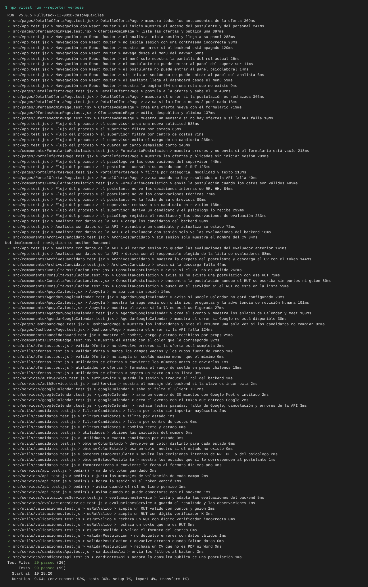

# AquaFiles

**Plataforma para centralizar la gestión de candidatos y evaluaciones psicolaborales de AquaChile.**

 **Demo publicada:** [AquaFiles en Vercel](https://full-stack-ii-002-d-caso-aqua-files.vercel.app/)

```text
Portal de empleos → Postulación con CV → Analista de Reclutamiento → Filtro técnico → Derivación con responsable → Evaluación psicolaboral → Resultado
```

## 📚 Documentación del proyecto

| Documento | Contenido |
| :--- | :--- |
| [Manual de usuario](docs/MANUAL_USUARIO.md) | Uso de cada pantalla con capturas: portal, postulación, acceso interno, ofertas, evaluación y dashboard |
| [Documento técnico de integración](docs/DOCUMENTO_TECNICO.md) | Arquitectura, modelo de datos, endpoints y Swagger, JWT, variables de entorno, CV, Google Calendar, IA y seguridad |
| [Informe de pruebas](docs/INFORME_PRUEBAS.md) | Pruebas unitarias y funcionales, cobertura del frontend y del backend, y cómo reproducirlas |
| [Guía de despliegue](docs/GUIA_DESPLIEGUE.md) | Publicar el frontend, el backend y la base de datos |
| [Backend](backend/README.md) | Requisitos, base de datos y variables del backend |

---

## Objetivo

Hoy el proceso de selección se apoya en planillas Excel, Planner y archivos repartidos en distintos lugares. **AquaFiles** reemplaza esas herramientas por una sola vista centralizada, donde se puede:

- Recibir postulaciones con un formulario estandarizado y el CV adjunto.
- Consultar los antecedentes de cada candidato en un expediente digital.
- Actualizar el estado de cada candidato a lo largo del proceso.
- Derivar al psicólogo los perfiles aprobados técnicamente, con su dossier.
- Seguir el avance del proceso con indicadores.

---

## Requerimientos del caso cubiertos

| Requerimiento | Cómo se cumple |
| :--- | :--- |
| RF01 Ingreso por rol | El postulante usa el portal sin cuenta. El analista y el evaluador inician sesión con JWT y usuarios de prueba |
| RF02 Registrar candidatos | Formulario con nombre, RUT, correo, teléfono, cargo, familia, ubicación, centro de costos y CV |
| RF03 Editar y consultar candidato | Ficha del analista con "Editar datos" |
| RF04 Crear solicitudes | Botón "Nueva solicitud" en el panel del analista |
| RF05 Cargo, familia, fecha y responsable | Fecha de solicitud automática y responsable obligatorio al derivar; el Dashboard muestra ambos |
| RF06 Listado y detalle | Tabla de solicitudes y ficha del candidato |
| RF07 Buscar y filtrar | Búsqueda por texto y filtros por estado y centro de costos |
| RF08 Estados | Pendiente → En proceso → Finalizada (columna "Etapa" del dashboard) |
| RF09 Evaluación | Fecha de entrevista, resultado y observaciones del evaluador |
| RF10 Dashboard | Página Dashboard del analista con indicadores y etapa de cada solicitud |

### Requerimientos de la Evaluación Parcial 3

| Punto de la pauta | Cómo se cumple |
| :--- | :--- |
| 1. Backend monolítico y persistencia | Spring Boot + MySQL con migraciones Flyway. Ofertas, postulaciones, archivos, evaluaciones y usuarios relacionados |
| 2. API REST y Swagger | CRUD con validaciones y errores coherentes, documentado en `/swagger-ui.html` |
| 3. Integración Full Stack | React consume la API con `fetch` y el token JWT; la información principal viene de la base de datos |
| 4. JWT, sesión y permisos | Login con BCrypt y JWT; permisos por rol en la API y en la interfaz; cierre de sesión |
| 5. Administración de ofertas | Página **Ofertas** del analista: crear, editar, publicar, despublicar y eliminar |
| 6. Portal público | Página **Empleos** sin login: búsqueda, filtro por categoría y modalidad, detalle y botón **Postular** |
| 7. Postulación y CV | Formulario validado; el CV se guarda en una carpeta privada `nombre-del-postulante-ID`, ligada a la postulación y a la oferta |
| 8. Evaluación y seguimiento | Solicitud con cargo y responsable, fechas, observaciones, estados (Pendiente, En proceso, Finalizada) y dashboard |
| 9. Inteligencia artificial | **Grok** sugiere al analista una puntuación orientativa, fortalezas, brechas y preguntas de entrevista, con criterios visibles, CV anonimizado y revisión humana obligatoria |
| 10. Pruebas y cobertura ≥ 85 % | Frontend **92,5 %** (96 pruebas) · Backend **95,4 %** (61 pruebas) |
| 11. Despliegue | Frontend en Vercel; backend según la [guía de despliegue](docs/GUIA_DESPLIEGUE.md) |
| Extra | Agenda de entrevistas en **Google Calendar con Meet**, basada en el ejemplo del profesor |

> Todos los datos son **ficticios**. No se usan nombres, RUT, teléfonos, correos ni CV reales.

---

## Roles y permisos

> 🔒 **Acceso por rol:** el portal de empleos y la postulación son públicos. El personal de AquaChile (analista y evaluador) inicia sesión y recibe un **token JWT**. La API valida el token y el rol en cada petición: sin sesión responde `401` y con el rol equivocado responde `403`, aunque se escriba la dirección a mano.

**Usuarios de prueba (ficticios):**

| Usuario | Contraseña | Nombre | Rol |
| :--- | :--- | :--- | :--- |
| `analista` | `aqua123` | Rosa Martínez | Analista de Reclutamiento |
| `evaluador` | `aqua123` | Luis Herrera | Profesional Evaluador |
| `evaluadora` | `aqua123` | Andrea Vidal | Profesional Evaluador |

> Los usuarios y tres ofertas de ejemplo se crean al iniciar el backend (`CREAR_USUARIOS_PRUEBA=true`). Las claves se guardan cifradas con BCrypt.

### Postulante / Candidato

- Ver las ofertas publicadas, buscarlas y filtrarlas por categoría y modalidad, sin crear una cuenta.
- Postular a una oferta con sus datos y su CV.
- Consultar el estado de su postulación con su RUT.

**No puede:** ver otros candidatos, decisiones internas, observaciones ni el dashboard.

### Analista de Reclutamiento

- Crear, editar, publicar y despublicar ofertas laborales.
- Pedir a la IA (Grok) una sugerencia sobre el CV: puntaje orientativo, brechas y preguntas de entrevista.
- Registrar candidatos y crear solicitudes ("Nueva solicitud").
- Descargar el CV de cada postulante.
- Buscar y filtrar por texto, estado y centro de costos.
- Editar datos del candidato y escribir observaciones técnicas.
- Aprobar o rechazar la etapa técnica.
- Derivar al evaluador a los candidatos aprobados, indicando el profesional responsable.
- Revisar el Dashboard con los indicadores del proceso.

**No puede:** redactar ni modificar la evaluación psicolaboral.

### Profesional Evaluador

- Ver solo las solicitudes derivadas.
- Descargar el CV y leer las observaciones del analista.
- Agendar la entrevista y crear la reunión en Google Calendar con enlace de Meet.
- Registrar el resultado y las observaciones de la evaluación.
- Subir el informe final y cerrar el proceso.

**No puede:** modificar la calificación técnica ni eliminar candidatos.

---

## Pantallas

| # | Pantalla | Usuario | Qué permite hacer |
| :---: | :--- | :--- | :--- |
| 1 | **Inicio** | Todos | Ir al portal de empleos, consultar una postulación o iniciar sesión |
| 2 | **Portal de empleos** | Público | Buscar y filtrar ofertas publicadas |
| 3 | **Detalle de la oferta** | Público | Ver todos los antecedentes y postular con CV |
| 4 | **Mi postulación** | Postulante | Consultar el estado con el RUT |
| 5 | **Inicio de sesión** | Analista y evaluador | Ingresar con usuario y contraseña |
| 6 | **Panel de Reclutamiento** | Analista | Tabla, filtros, nueva solicitud, ficha con CV, edición, aprobación, rechazo y derivación con responsable |
| 7 | **Ofertas** | Analista | Crear, editar, publicar, despublicar y eliminar ofertas |
| 8 | **Dashboard** | Analista | Indicadores Pendientes / En proceso / Finalizadas, resumen por familia y ubicación, y responsable de cada solicitud |
| 9 | **Panel de Evaluaciones** | Evaluador | Solicitudes derivadas, CV, entrevista con Google Calendar, resultado e informe |
| 10 | **Acceso restringido / 404** | Todos | Aviso cuando la ruta no corresponde al rol o no existe |

### Funcionalidades

| Funcionalidad | Reemplaza a | Prioridad | En la demo actual |
| :--- | :--- | :---: | :---: |
| Formulario de postulación con validaciones y CV | Recepción de CV por correo | Alta | ✅ Disponible |
| Registro de candidatos y solicitudes por el analista | Planillas Excel | Alta | ✅ Disponible |
| Tabla con búsqueda y filtros por estado y centro de costos | Planillas Excel | Alta | ✅ Disponible |
| Edición de datos y observaciones técnicas | Correcciones manuales | Alta | ✅ Disponible |
| Aprobación, rechazo y derivación al evaluador | Tareas en Planner | Alta | ✅ Disponible |
| Resultado e informe de la evaluación | Envío del informe por correo | Alta | ✅ Disponible |
| Consulta de postulación por RUT | Consultas por correo | Media | ✅ Disponible |
| Dashboard con indicadores | Cálculos manuales | Media | ✅ Disponible |
| Asignar un profesional responsable al derivar | Coordinación por correo | Media | ✅ Disponible |
| Persistencia en base de datos (MySQL) | — | Alta | ✅ Disponible |
| Publicación de ofertas y portal público | Avisos en sitios externos | Alta | ✅ Disponible |
| CV en carpeta privada por postulante | Carpetas compartidas | Alta | ✅ Disponible |
| Agenda en Google Calendar con Meet | Agendamiento por Teams | Media | ✅ Disponible |
| Apoyo de IA al analista (Grok) | Revisión manual de CV | Media | ✅ Disponible |

---

## Flujo principal

1. El analista publica una oferta. El postulante la encuentra en el portal y postula con su CV (o el analista lo registra con `Nueva solicitud`). La solicitud queda `En revisión técnica` y el CV, en la carpeta privada del postulante.
2. El analista revisa la ficha, corrige datos si hace falta y escribe observaciones técnicas.
3. El analista aprueba (`Aprobado técnicamente`) o rechaza (`Rechazado técnicamente`).
4. Si aprueba, elige el profesional responsable y presiona `Derivar al evaluador`. El estado pasa a `Derivado a psicólogo`.
5. El evaluador agenda la entrevista (`Agendado`), puede crear la reunión en Google Calendar y registra el resultado y sus observaciones.
6. El evaluador sube el informe y el proceso queda `Proceso Finalizado`.
7. El dashboard y el seguimiento del postulante se actualizan.

**Estados del candidato:**

```text
En revisión técnica ──→ Rechazado técnicamente
        ↓
Aprobado técnicamente
        ↓
Derivado a psicólogo
        ↓
Agendado
        ↓
Proceso Finalizado
```

### Diagrama de flujo

El diagrama muestra el proceso completo del MVP.

```mermaid
flowchart TD
    INI(["Inicio"]) --> A1

    subgraph P1["1. Portal del Postulante"]
        A1["Candidato ingresa a la plataforma web"] --> A2["Completa formulario estandarizado"]
        A2 --> A3["Adjunta Curriculum Vitae (PDF/Word)"]
        A3 --> A4["Envía postulación<br/>Estado: En revisión técnica"]
        N1["- Datos personales<br/>- Familia de cargo<br/>- Ubicación / Planta<br/>- Cargo al que postula"]
        A2 -.- N1
    end

    subgraph P2["2. Panel de Reclutamiento (Analista de Reclutamiento)"]
        B1["Analista de Reclutamiento visualiza el registro en la tabla general"] --> B2["Abre la ficha técnica y dossier del postulante"]
        B2 --> D1{"¿Se requiere editar o corregir datos?"}
        D1 -- Sí --> B3["Modificar información (Cargo, Ubicación, CC)"]
        B3 --> B4
        D1 -- No --> B4["Evalúa requisitos técnicos y antecedentes del candidato"]
        B4 --> D2{"¿Aprueba la evaluación técnica?"}
        D2 -- No --> B5["Estado: Rechazado técnicamente"]
        B5 --> B6["Archivar postulación"]
        B6 --> FIN1(["Fin"])
        D2 -- Sí --> B7["Estado: Aprobado técnicamente"]
        B7 --> B8["Genera el dossier técnico del candidato"]
        B8 --> B9["Derivar al evaluador"]
    end

    subgraph P3["3. Evaluación Psicolaboral"]
        C1["Profesional Evaluador recibe el dossier con CV y datos"] --> C2["Agenda entrevista psicológica (Google Calendar + Meet)<br/>Estado: Agendado"]
        C2 --> C3["Realiza entrevista y toma de notas"]
        C3 --> C4["Elabora informe psicolaboral (con apoyo de Copilot)"]
        C4 --> C5["Sube el informe psicolaboral final a la plataforma"]
        C5 --> C6["Estado: Proceso Finalizado"]
    end

    subgraph P4["4. Centralización & Dashboard (KPIs)"]
        E1["Sistema actualiza el pipeline general de candidatos"] --> E2["Consolida indicadores de gestión"]
        E2 --> E3["Proceso finalizado exitosamente"]
        N2["- Candidatos por estado<br/>- Timing promedio (solicitud vs. informe)<br/>- Volúmenes por familia de cargo y ubicación"]
        E2 -.- N2
    end

    A4 --> B1
    B9 --> C1
    C6 --> E1
    E3 --> FIN2(["Fin"])

    classDef actividad fill:#F4F6F9,stroke:#1E3A8A,color:#0F172A;
    classDef decision fill:#FEF3C7,stroke:#D97706,color:#0F172A;
    classDef nota fill:#EFF6FF,stroke:#3B82F6,color:#0F172A;
    classDef limite fill:#1E3A8A,stroke:#1E3A8A,color:#FFFFFF;

    class A1,A2,A3,A4,B1,B2,B3,B4,B5,B6,B7,B8,B9,C1,C2,C3,C4,C5,C6,E1,E2,E3 actividad;
    class D1,D2 decision;
    class N1,N2 nota;
    class INI,FIN1,FIN2 limite;

    style P1 fill:#F1F5F9,stroke:#94A3B8,color:#1E293B
    style P2 fill:#F1F5F9,stroke:#94A3B8,color:#1E293B
    style P3 fill:#F1F5F9,stroke:#94A3B8,color:#1E293B
    style P4 fill:#F1F5F9,stroke:#94A3B8,color:#1E293B
    linkStyle default stroke:#2563EB
```



> El análisis completo de roles, interfaces y flujo (incluido el diagrama original en PlantUML) está en [`docs/Actividad_Bases_MVP_AquaChile_DSY1104.md`](docs/Actividad_Bases_MVP_AquaChile_DSY1104.md) (también disponible en [PDF](docs/Actividad_Bases_MVP_AquaChile_DSY1104.pdf)).

---

## Cómo probar el MVP

Puede usar la [demo publicada](https://full-stack-ii-002-d-caso-aqua-files.vercel.app/) o ejecutarla localmente (ver [Información técnica](#información-técnica)).

Antes de probar, levanta el backend y el frontend (ver [Ejecutar localmente](#ejecutar-localmente)).

**Como Postulante (sin cuenta):**

1. En el inicio, elegir `Ofertas laborales`, filtrar por una categoría y abrir `Ver detalle`.
2. Presionar `Postular`, completar el formulario con un RUT ficticio (por ejemplo `12.345.678-5`), adjuntar un PDF de prueba y enviar.

**Como Analista de Reclutamiento:**

3. `Personal AquaChile` → `analista` / `aqua123`.
4. En `Ofertas`, crear una oferta y publicarla. Se ve de inmediato en el portal.
5. En `Reclutamiento`, abrir la postulación, descargar el CV, aprobar, elegir un responsable y `Derivar al evaluador`.
6. Abrir `Dashboard` para ver los indicadores.

**Como Profesional Evaluador:**

7. `Cerrar sesión` → `Personal AquaChile` → `evaluador` / `aqua123`.
8. Elegir al candidato, indicar la fecha de entrevista (opcional: crear el evento en Google Calendar), elegir el resultado, `Guardar evaluación` y subir el informe.

**Como Postulante otra vez:**

9. `Postulante / Candidato` → consultar con el RUT: se ve el estado general y la fecha, sin información interna.
10. Escribir `/supervisor` en la barra de direcciones sin sesión: aparece "Acceso restringido".

---

## Preguntas abiertas

Puntos que necesitamos confirmar con AquaChile para las próximas etapas:

1. ¿Qué ve el postulante si queda fuera del proceso?
2. ¿Teams y Copilot se conectan a la plataforma o se usan por fuera?
3. ¿El sistema debe enviar correos automáticos?
4. ¿Cómo se mide exactamente el tiempo del proceso?
5. ¿Hasta qué momento el analista puede corregir datos?
6. ¿El candidato puede cambiar su CV si se equivocó?

---

## Estado del proyecto

AquaFiles es un MVP **Full Stack**: frontend en React integrado con un backend monolítico en Spring Boot y MySQL.

Implementado:

- Autenticación JWT con permisos por rol en la API y en la interfaz.
- Ofertas laborales con administración y portal público.
- Postulación con CV guardado en una carpeta privada por postulante.
- Filtros, estados, derivación con responsable, agendamiento y finalización del proceso.
- Agenda de entrevistas en Google Calendar con enlace de Meet.
- Apoyo de IA con **Grok** para el analista, con CV anonimizado y revisión humana obligatoria.
- Pruebas unitarias y funcionales con cobertura sobre el 85 % en el frontend y en el backend.

Pendiente:

- Notificaciones por correo y historial de cambios por solicitud.
- Almacenamiento de archivos en un servicio gestionado (S3 o similar) para producción.

---

## Rutas de la aplicación

| Ruta | Pantalla | Acceso |
| :--- | :--- | :--- |
| `/` | Inicio | Todos |
| `/login` | Inicio de sesión del personal | Todos |
| `/empleos` | Portal público de ofertas | Público |
| `/empleos/:id` | Detalle de la oferta y postulación | Público |
| `/postulacion` | Consulta de la postulación por RUT | Postulante |
| `/supervisor` | Panel de Reclutamiento | Analista (con sesión) |
| `/ofertas` | Administración de ofertas | Analista (con sesión) |
| `/dashboard` | Dashboard con indicadores | Analista (con sesión) |
| `/psicologo` | Panel de Evaluaciones | Evaluador (con sesión) |
| `*` | Página no encontrada (404) | Todos |

## Pruebas y cobertura

| Proyecto | Pruebas | Cobertura de líneas | Comando |
| :--- | :---: | :---: | :--- |
| Frontend (Vitest + Testing Library) | 96 | **92,5 %** | `npm run coverage` |
| Backend (JUnit + MockMvc + JaCoCo) | 61 | **95,4 %** | `cd backend && mvn verify` |

Cada proyecto falla si su cobertura baja del 85 %. Las pruebas del backend usan **H2 en memoria**, así que no necesitan MySQL. El detalle de cada prueba, los escenarios de la pauta y las evidencias están en el [Informe de pruebas](docs/INFORME_PRUEBAS.md).



## Información técnica

### Tecnologías

| Parte | Tecnologías |
| :--- | :--- |
| Frontend | React 19, React Router 7, Vite, Bootstrap 5, Bootstrap Icons |
| Backend | Java 21, Spring Boot 3.5, Spring Security con JWT, Spring Data JPA, Swagger (springdoc) |
| Base de datos | MySQL 8 con migraciones Flyway (H2 solo en pruebas) |
| Pruebas | Vitest, React Testing Library, user-event, JUnit 5, Mockito, MockMvc, JaCoCo |
| Integraciones | Grok (API de xAI) para el apoyo de IA · Google Calendar API + Google Meet · Apache PDFBox |
| Calidad y despliegue | Oxlint, Vercel |

### Estructura del repositorio

```text
FullStack-II-002D-CasoAquaFiles/
├── backend/                           # API REST en Spring Boot (monolito)
│   ├── src/main/java/.../controller/  # Endpoints /api/v1/...
│   ├── src/main/java/.../service/     # Reglas de negocio
│   ├── src/main/java/.../security/    # Filtro y servicio JWT
│   ├── src/main/resources/db/migration/ # Migraciones Flyway V1 a V6
│   └── src/test/                      # Pruebas JUnit, MockMvc y perfil H2
├── docs/
│   ├── MANUAL_USUARIO.md              # Manual con capturas
│   ├── DOCUMENTO_TECNICO.md           # Arquitectura, API, JWT, CV, seguridad
│   ├── INFORME_PRUEBAS.md             # Pruebas y cobertura
│   ├── GUIA_DESPLIEGUE.md
│   ├── manual/                        # Capturas del manual
│   └── evidencias/                    # Resultados y reportes de pruebas
├── src/
│   ├── components/                    # Componentes reutilizables
│   ├── data/                          # Estados, roles, modalidades y datos de demostración
│   ├── pages/                         # Una página por ruta
│   ├── services/                      # Llamadas a la API, sesión y Google Calendar
│   ├── test/                          # API simulada para las pruebas
│   ├── utils/                         # Búsqueda, filtros y validaciones
│   ├── App.jsx                        # Estado global y rutas
│   └── main.jsx                       # Entrada de React y Router
├── .env.example                       # Variables del frontend (sin valores reales)
├── vercel.json
├── vite.config.ts                     # Vite, Vitest y cobertura
└── README.md
```

### Ejecutar localmente

**1. Base de datos:** crear la base `aquafiles` en MySQL (ver [`backend/README.md`](backend/README.md)).

**2. Backend** (puerto 8080):

```bash
cd backend
cp .env.example .env      # completar DB_CLAVE y JWT_SECRETO
mvn spring-boot:run
```

Documentación de la API: http://localhost:8080/swagger-ui.html

**3. Frontend** (puerto 5173), en otra terminal:

```bash
cp .env.example .env.local   # VITE_API_URL y, opcional, VITE_GOOGLE_CLIENT_ID
npm install
npm run dev
```

### Comandos disponibles

```bash
npm run dev         # Entorno de desarrollo
npm run build       # Versión de producción
npm run lint        # Revisa el código con Oxlint
npm run test:run    # Pruebas del frontend
npm run coverage    # Pruebas + cobertura del frontend
cd backend && mvn verify   # Pruebas + cobertura del backend
```

### Despliegue

El frontend está publicado en **Vercel** (`vercel.json`: Framework `Vite`, Build Command `npm run build`, Output Directory `dist`). Para que la demo publicada use datos reales, el backend debe estar publicado y `VITE_API_URL` configurada en Vercel. Los pasos para el backend y la base de datos están en la [Guía de despliegue](docs/GUIA_DESPLIEGUE.md).

---

## Equipo

| | |
| :--- | :--- |
| **Integrantes** | Felipe Barra · Aolani Caiguan · Renata Orellana |
| **Proyecto** | DSY1104 Full Stack II — Caso AquaChile |
