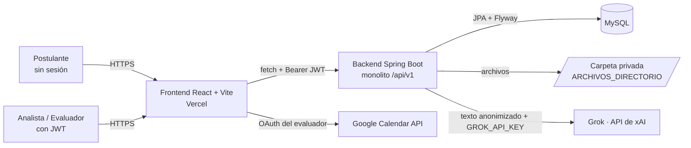
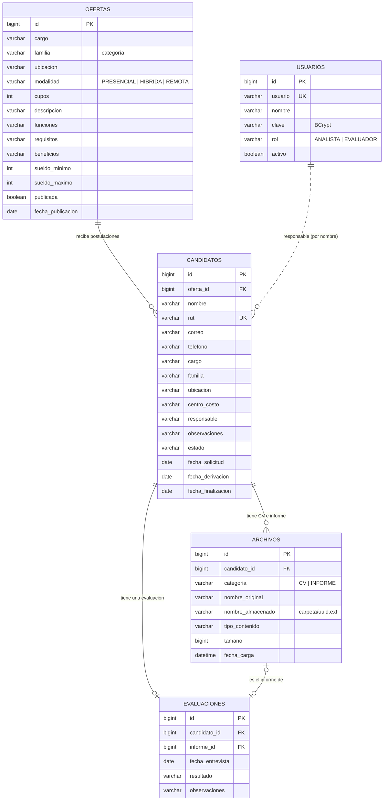
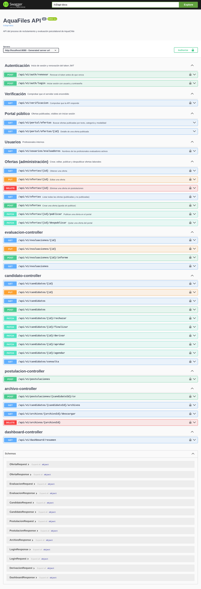
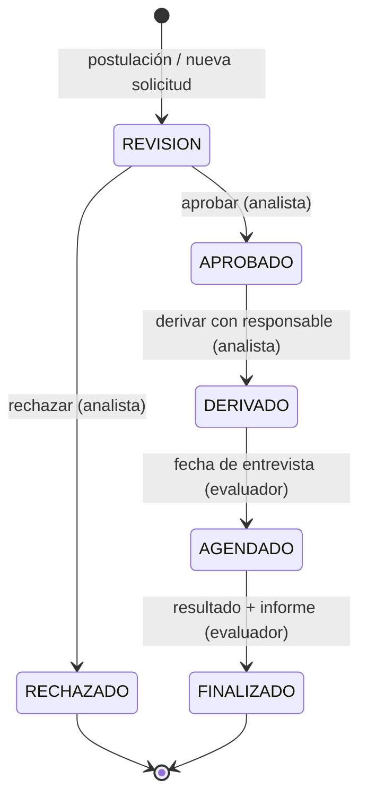
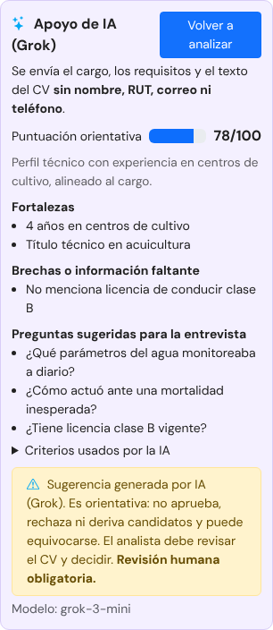
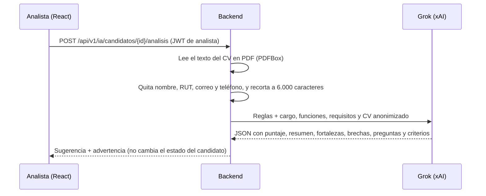

# Documento técnico de integración · AquaFiles

Este documento describe cómo está construido AquaFiles: arquitectura, modelo de datos, API, seguridad, almacenamiento de CV, integraciones externas, variables de entorno y despliegue.

## Contenido

1. [Arquitectura](#1-arquitectura)
2. [Tecnologías](#2-tecnologías)
3. [Modelo de datos](#3-modelo-de-datos)
4. [API REST y Swagger](#4-api-rest-y-swagger)
5. [Autenticación JWT, sesión y permisos](#5-autenticación-jwt-sesión-y-permisos)
6. [Flujo de estados](#6-flujo-de-estados)
7. [Almacenamiento de CV e informes](#7-almacenamiento-de-cv-e-informes)
8. [Integración con Google Calendar](#8-integración-con-google-calendar)
9. [Integración de inteligencia artificial](#9-integración-de-inteligencia-artificial)
10. [Variables de entorno](#10-variables-de-entorno)
11. [Ejecución local y despliegue](#11-ejecución-local-y-despliegue)
12. [Decisiones de seguridad](#12-decisiones-de-seguridad)

---

## 1. Arquitectura

Monorepositorio con dos proyectos: el frontend en la raíz y el backend en `backend/`.



- **Frontend:** SPA en React. Llama a la API con `fetch` (`src/services/api.js`), que agrega el token, traduce los errores HTTP a mensajes en español y borra la sesión ante un 401.
- **Backend:** monolito en capas `controller → service → repository → entity`. Toda la lógica de negocio (transiciones de estado, reglas de ofertas, validación de archivos) está en los servicios.
- **Base de datos:** MySQL, versionada con migraciones Flyway (`V1` a `V6`).

## 2. Tecnologías

| Capa | Tecnologías |
| :--- | :--- |
| Frontend | React 19, React Router 7, Vite 8, Bootstrap 5, Bootstrap Icons |
| Backend | Java 21, Spring Boot 3.5, Spring Web, Spring Data JPA, Spring Security, Bean Validation |
| Seguridad | JWT (jjwt 0.12), BCrypt |
| Base de datos | MySQL 8 + Flyway. H2 en memoria solo para las pruebas |
| Documentación API | springdoc-openapi 2.8 (Swagger UI) |
| Pruebas | Vitest, React Testing Library, user-event, `@vitest/coverage-v8` · JUnit 5, Mockito, MockMvc, JaCoCo |
| Integraciones | Google Identity Services + Google Calendar API · Grok (API de xAI) · Apache PDFBox para leer el CV |

## 3. Modelo de datos



| Concepto del caso | Dónde está |
| :--- | :--- |
| Oferta laboral | Tabla `ofertas` |
| Postulante y postulación | Tabla `candidatos` (una postulación por RUT), ligada a `ofertas` por `oferta_id` |
| Solicitud de evaluación | Se crea en `evaluaciones` al derivar al candidato |
| Responsable | `candidatos.responsable`: nombre de un usuario con rol `EVALUADOR` |
| Estados | `candidatos.estado` (ver [sección 6](#6-flujo-de-estados)) |

**Migraciones Flyway** (`backend/src/main/resources/db/migration`):

| Versión | Cambio |
| :--- | :--- |
| V1 | Tabla `usuarios` |
| V2 | Tabla `candidatos` |
| V3 | Tabla `archivos` |
| V4 | Tabla `evaluaciones` |
| V5 | Columna `archivos.categoria` (CV o INFORME) |
| V6 | Tabla `ofertas` y `candidatos.oferta_id` |

> Una migración ya aplicada **no se modifica**: Flyway valida su checksum. Los cambios nuevos van en `V7`, `V8`, etc.

## 4. API REST y Swagger

- Base: `/api/v1`.
- Documentación interactiva: **`http://localhost:8080/swagger-ui.html`** (JSON en `/v3/api-docs`). El botón **Authorize** acepta el token JWT.



| Método | Ruta | Acceso | Descripción |
| :--- | :--- | :--- | :--- |
| POST | `/auth/login` | Público | Inicia sesión y devuelve el JWT |
| POST | `/auth/renovar` | Con sesión | Entrega un token nuevo |
| GET | `/verificacion` | Público | Comprueba que la API está encendida |
| GET | `/portal/ofertas?busqueda=&familia=&modalidad=` | Público | Ofertas publicadas con filtros |
| GET | `/portal/ofertas/{id}` | Público | Detalle de una oferta publicada |
| POST | `/postulaciones` | Público | Registra la postulación (con `ofertaId`) |
| POST | `/postulaciones/{id}/cv` | Público, una vez | Sube el CV de la postulación |
| GET | `/candidatos/consulta?rut=` | Público | Estado general de la postulación por RUT |
| GET, POST | `/ofertas` | Analista | Listar y crear ofertas |
| GET, PUT, DELETE | `/ofertas/{id}` | Analista | Ver, editar y eliminar (si no tiene postulaciones) |
| PATCH | `/ofertas/{id}/publicar` · `/despublicar` | Analista | Publicar o quitar del portal |
| GET, POST | `/candidatos` | Analista | Listar con filtros y crear |
| GET, PUT | `/candidatos/{id}` | Analista | Ver y editar |
| PATCH | `/candidatos/{id}/aprobar` · `/rechazar` | Analista | Etapa técnica |
| PATCH | `/candidatos/{id}/derivar` | Analista | Deriva con `{"responsable": "..."}` |
| PATCH | `/candidatos/{id}/agendar` · `/finalizar` | Evaluador | Cambios de estado del evaluador |
| GET | `/candidatos/{id}/archivos` | Analista y evaluador | Lista el CV y el informe |
| GET | `/archivos/{id}/descargar` | Analista y evaluador | Descarga el archivo |
| DELETE | `/archivos/{id}` | Analista | Elimina un archivo |
| GET | `/evaluaciones` · `/evaluaciones/{id}` | Evaluador | Solicitudes de evaluación |
| PUT | `/evaluaciones/{id}` | Evaluador | Fecha, resultado y observaciones |
| POST | `/evaluaciones/{id}/informe` | Evaluador | Sube el informe y finaliza el proceso |
| GET | `/usuarios/evaluadores` | Analista | Responsables disponibles |
| GET | `/dashboard/resumen` | Analista | Indicadores del proceso |
| POST | `/ia/candidatos/{id}/analisis` | Analista | Sugerencia de Grok: puntaje orientativo, fortalezas, brechas, preguntas y criterios |

**Respuestas de error.** Todas tienen el mismo formato (`ManejadorErrores`):

```json
{ "fecha": "2026-11-25T23:37:29", "estado": 400, "mensaje": "Hay datos inválidos en el formulario.",
  "campos": { "modalidad": "La modalidad es obligatoria." } }
```

| Código | Cuándo |
| :---: | :--- |
| 400 | Validación (`@Valid`), JSON mal escrito, parámetro inválido, archivo con formato o tamaño no permitido |
| 401 | Sin token, token falso o vencido, o credenciales incorrectas |
| 403 | El rol no tiene permiso para esa ruta |
| 404 | El recurso no existe (o la oferta no está publicada, para el portal) |
| 503 | El apoyo de IA no está configurado o Grok no respondió (el resto del sistema sigue funcionando) |
| 409 | Regla de negocio: RUT duplicado, cambio de estado no permitido, segundo CV, eliminar una oferta con postulaciones |

## 5. Autenticación JWT, sesión y permisos

1. `POST /auth/login` compara la clave con el hash **BCrypt** guardado y responde con un **JWT** firmado con `JWT_SECRETO` (HMAC). El token incluye el usuario (`sub`), el rol y el nombre, y vence a los `JWT_EXPIRACION_MINUTOS` (60 por defecto).
2. El frontend guarda la sesión en `localStorage` (`src/services/sesion.js`) y envía `Authorization: Bearer <token>` en cada petición.
3. `JwtFiltro` valida la firma y la fecha de vencimiento en cada petición. Si el token no es válido, la petición sigue **sin usuario** y Spring Security responde 401.
4. `SecurityConfig` define los permisos por ruta y rol (tabla de la [sección 4](#4-api-rest-y-swagger)). El servidor es **sin estado** (`STATELESS`): no hay sesiones en memoria.
5. **Cerrar sesión** borra el token del navegador. Si la API responde 401 (token vencido), el frontend también borra la sesión y pide iniciar sesión otra vez.

**Doble protección.** En el frontend, `RutaProtegida` oculta las pantallas que no corresponden al rol. En el backend, cada ruta interna exige el rol correcto. Ocultar un botón no reemplaza la autorización: sin el rol adecuado, la API responde 403 aunque se llame directamente.

Se usan solo dos roles internos, **ANALISTA** y **EVALUADOR**, como en el flujo del caso. El postulante no tiene cuenta: usa las rutas públicas.

## 6. Flujo de estados



`CandidatoService.transicionPermitida` rechaza con 409 cualquier salto que no esté en el diagrama. Para el dashboard, los estados se agrupan en los tres de referencia del caso:

| Etapa | Estados |
| :--- | :--- |
| **Pendiente** | REVISION |
| **En proceso** | APROBADO, DERIVADO, AGENDADO |
| **Finalizada** | FINALIZADO, RECHAZADO |

El postulante ve una versión simplificada (`EstadoCandidato.etiquetaParaPostulante`) que no revela decisiones internas.

## 7. Almacenamiento de CV e informes

Al confirmar la postulación, el frontend registra la postulación y luego sube el CV. El backend (`ArchivoService`):

1. **Valida** que el archivo exista, pese como máximo 5 MB y sea `.pdf`, `.doc` o `.docx`.
2. **Crea automáticamente la carpeta del postulante** dentro de `ARCHIVOS_DIRECTORIO`, con su nombre sin tildes ni espacios y su identificador único: por ejemplo, `uploads/maria-jose-nunez-1/`.
3. Guarda el archivo con un nombre aleatorio (UUID) para que no se repita ni revele datos: `uploads/maria-jose-nunez-1/14114f39-….pdf`.
4. Registra el archivo en la tabla `archivos`, ligado al candidato y, por medio de él, a la oferta.
5. El informe psicolaboral se guarda en la misma carpeta, con categoría `INFORME`.

**Privacidad y acceso:**

- La carpeta está fuera del frontend y no se publica como recurso estático. Solo se accede por `GET /archivos/{id}/descargar`, que exige rol analista o evaluador.
- La subida pública del CV se permite **una sola vez** por postulación, para que nadie reemplace el CV de otra persona.
- Las rutas guardadas se validan para que no salgan del directorio base (protección contra `../`).
- `uploads/` está en `.gitignore`.

**Persistencia.** El almacenamiento es en disco del servidor, así que `ARCHIVOS_DIRECTORIO` debe apuntar a un volumen persistente (por ejemplo, un *disk* de Render o un volumen de Railway). Un proveedor sin disco persistente perdería los archivos al reiniciar.

## 8. Integración con Google Calendar

Basada en el ejemplo `aqua-calendar` entregado por el profesor (`src/services/googleCalendar.js` y `src/components/AgendarGoogleCalendar.jsx`):

1. Con la entrevista agendada, el evaluador elige la hora y presiona **Crear evento con Google Meet**.
2. **Google Identity Services** (`index.html` carga `https://accounts.google.com/gsi/client`) abre la ventana de permiso de Google y entrega un token de acceso con el permiso `calendar.events`.
3. El frontend crea el evento en el calendario del evaluador (`POST https://www.googleapis.com/calendar/v3/calendars/primary/events?conferenceDataVersion=1&sendUpdates=all`): 30 minutos, enlace de Google Meet e invitación al correo del candidato.
4. Se muestran los enlaces **Ver en Google Calendar** y **Entrar a Google Meet**.

**Configuración:**

1. En Google Cloud Console, crea un **ID de cliente de OAuth** de tipo "Aplicación web".
2. En **Orígenes de JavaScript autorizados**, agrega `http://localhost:5173` y la URL de Vercel.
3. Activa la **Google Calendar API** en el proyecto.
4. Define `VITE_GOOGLE_CLIENT_ID` en `.env.local` (local) y en Vercel.

El token de Google **no** pasa por el backend ni se guarda: Google lo entrega directamente al navegador del evaluador. Sin `VITE_GOOGLE_CLIENT_ID`, el bloque muestra "Google Calendar no está configurado" y el resto del sistema funciona igual.

## 9. Integración de inteligencia artificial

AquaFiles usa **Grok** (modelo `grok-3-mini` de xAI, configurable con `GROK_MODELO`) como **apoyo al analista** en la ficha del candidato. Se eligió la opción de la pauta "puntuación orientativa de adecuación del CV al cargo", complementada con preguntas sugeridas para la entrevista.



**Cómo funciona** (`IaService`, `ClienteGrok`, `Anonimizador`):



1. El analista presiona **Analizar CV con IA**.
2. El backend toma el cargo, las funciones y los requisitos de la **oferta**, las observaciones técnicas y el **texto del CV** (solo PDF).
3. `Anonimizador` reemplaza el nombre (con o sin tildes), el RUT, los correos y los teléfonos por `[nombre]`, `[rut]`, `[correo]` y `[teléfono]`.
4. Se envía a Grok con instrucciones fijas (`IaService.INSTRUCCIONES`): evaluar solo experiencia, formación y habilidades relacionadas con el cargo, ignorar edad, género, origen, salud y otros datos personales, y declarar la información faltante en vez de inventarla.
5. La respuesta se valida: debe ser JSON y el puntaje se limita a 0–100. Si Grok falla o responde en otro formato, la API devuelve **503** con un mensaje claro.

**Revisión humana y límites (punto 9.a de la pauta):**

| Requisito | Cómo se cumple |
| :--- | :--- |
| Apoyo, no decisión | El endpoint **no modifica** al candidato. Aprobar, rechazar y derivar siguen siendo botones manuales del analista |
| Criterios visibles | La sugerencia muestra los **criterios** con que se llegó al puntaje, las fortalezas y las brechas |
| Advertir limitaciones | Cada respuesta incluye la advertencia "Sugerencia generada por IA… puede equivocarse" y el texto **"Revisión humana obligatoria"** |
| Sin datos sensibles a terceros | Solo sale el texto anonimizado: nunca el nombre, el RUT, el correo, el teléfono ni el archivo del CV. En la demo se usan CV ficticios |
| Clave segura | `GROK_API_KEY` vive solo en el backend (variable de entorno). El frontend nunca ve la clave |
| Sesgos | Las instrucciones prohíben usar datos personales para evaluar |

**Limitaciones conocidas.** Solo se lee el texto de CV en PDF (un Word se evalúa sin CV, y la pantalla lo avisa). El puntaje depende del modelo y puede variar entre ejecuciones. No se guarda la sugerencia: es una ayuda puntual para el analista.

**Configuración:** crear una clave en https://console.x.ai y definir `GROK_API_KEY` en `backend/.env` (local) o en Render. Sin la clave, el botón responde "El apoyo de IA no está configurado" y el resto del sistema funciona igual.

## 10. Variables de entorno

**Backend** (`backend/.env`, ver `backend/.env.example`):

| Variable | Uso | Valor por defecto |
| :--- | :--- | :--- |
| `DB_URL` | URL JDBC de MySQL | `jdbc:mysql://localhost:3306/aquafiles?...` |
| `DB_USUARIO` / `DB_CLAVE` | Credenciales de la base | `aquafiles` / (obligatoria) |
| `JWT_SECRETO` | Clave para firmar los JWT (mínimo 32 caracteres) | Solo para desarrollo |
| `JWT_EXPIRACION_MINUTOS` | Duración del token | `60` |
| `CORS_ORIGENES` | Orígenes del frontend, separados por coma | `http://localhost:5173` |
| `ARCHIVOS_DIRECTORIO` | Carpeta privada de CV e informes | `uploads` |
| `CREAR_USUARIOS_PRUEBA` | Crea los usuarios y ofertas ficticias al arrancar | `true` |
| `CLAVE_USUARIOS_PRUEBA` | Clave de los usuarios ficticios | `aqua123` |
| `GROK_API_KEY` | Clave de la API de xAI (Grok). Sin ella, la IA responde 503 | (vacía) |
| `GROK_MODELO` | Modelo de Grok | `grok-3-mini` |
| `GROK_URL` | Dirección de la API | `https://api.x.ai/v1/chat/completions` |
| `PORT` | Puerto HTTP | `8080` |

**Frontend** (`.env.local`, ver `.env.example`):

| Variable | Uso |
| :--- | :--- |
| `VITE_API_URL` | URL de la API, por ejemplo `http://localhost:8080/api/v1` |
| `VITE_GOOGLE_CLIENT_ID` | ID de cliente OAuth de Google para Calendar |

Los archivos `.env`, `.env.local` y `backend/.env` están en `.gitignore`. Solo se suben los `.env.example`, sin valores reales.

## 11. Ejecución local y despliegue

**Local:**

```bash
# 1. Base de datos: crear "aquafiles" en MySQL (ver backend/README.md)
# 2. Backend
cd backend
cp .env.example .env      # completar DB_CLAVE y JWT_SECRETO
mvn spring-boot:run       # http://localhost:8080  ·  Swagger: /swagger-ui.html
# 3. Frontend (otra terminal, en la raíz)
cp .env.example .env.local
npm install
npm run dev               # http://localhost:5173
```

**Despliegue:** ver [`GUIA_DESPLIEGUE.md`](GUIA_DESPLIEGUE.md). En resumen:
- Frontend en **Vercel** (`vercel.json` ya redirige las rutas de la SPA), con `VITE_API_URL` y `VITE_GOOGLE_CLIENT_ID`.
- Backend en **Render** con Docker (`backend/Dockerfile` y `render.yaml`), con las variables de la sección 10.
- MySQL administrado en **Aiven** (plan gratuito, conexión con SSL).
- En Render gratis el disco no es persistente: los CV sirven para la demostración, pero se pierden al redesplegar. En producción se usaría un disco persistente o un servicio de archivos.

Si no se dispone de backend público, la demostración se hace en local y se justifica en la presentación (límites de los planes gratuitos).

## 12. Decisiones de seguridad

| Decisión | Motivo |
| :--- | :--- |
| Claves con **BCrypt** | Nunca se guarda la contraseña original |
| **JWT sin estado** con vencimiento | Escala sin sesiones en el servidor; un token robado deja de servir al vencer |
| Permisos por rol **en el backend** | El frontend solo oculta; la API es la que autoriza |
| CSRF deshabilitado | La API no usa cookies; el token va en la cabecera `Authorization` |
| CORS limitado a `CORS_ORIGENES` | Solo el frontend propio puede llamar a la API desde el navegador |
| Validación de **tipo y tamaño** de archivo en el backend | No se confía en la validación del navegador |
| Un solo CV por postulación pública | Evita que se reemplace el CV de otra persona |
| CV en carpeta privada con nombre UUID | Los archivos no son públicos ni adivinables |
| El postulante ve solo **estados generales** | No se exponen decisiones ni observaciones internas |
| Secretos solo en variables de entorno | El repositorio no contiene claves ni `.env` |
| Usuarios de prueba desactivables (`CREAR_USUARIOS_PRUEBA=false`) | En producción no existen cuentas con clave conocida |
| Solo datos ficticios | Lo exige la pauta; no se publica información de personas reales |
| CV anonimizado antes de enviarlo a Grok | Ningún dato personal sale hacia el proveedor de IA |

**Riesgo conocido.** El token se guarda en `localStorage`, que es accesible por JavaScript. Una vulnerabilidad XSS podría leerlo. React escapa el contenido por defecto y la app no usa `dangerouslySetInnerHTML`; para producción se recomienda una cookie `HttpOnly` con protección CSRF.
