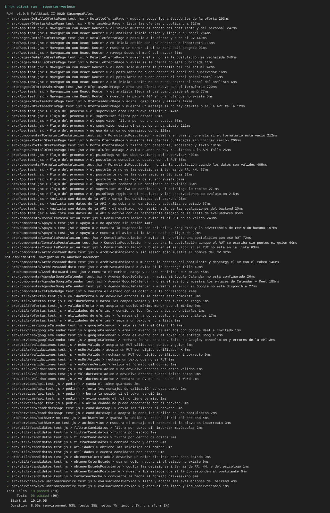
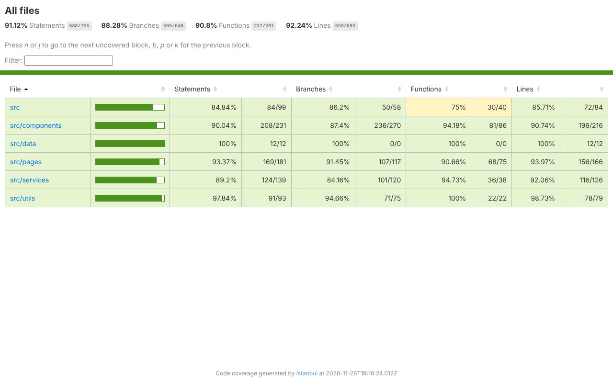
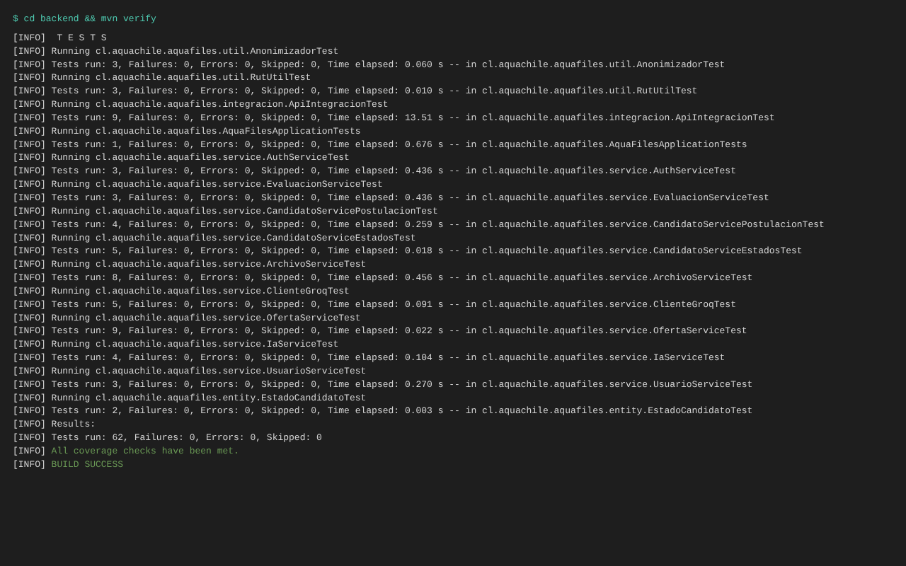
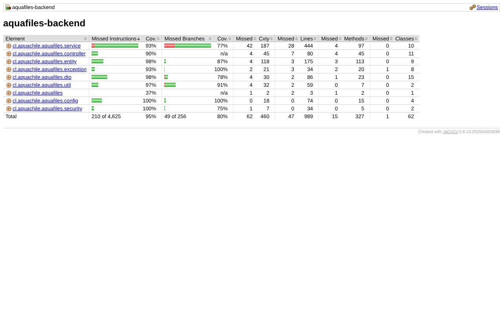

# Informe de pruebas · AquaFiles

## Resumen

| Proyecto | Herramientas | Pruebas | Cobertura de líneas | Mínimo exigido |
| :--- | :--- | :---: | :---: | :---: |
| **Frontend** | Vitest + React Testing Library + user-event + `@vitest/coverage-v8` | **96** en 19 archivos | **92,24 %** | 85 % ✅ |
| **Backend** | JUnit 5 + Mockito + MockMvc + JaCoCo | **62** en 14 clases | **95,2 %** | 85 % ✅ |

Las dos coberturas se miden por separado y cada proyecto **falla automáticamente** si sus líneas cubiertas bajan del 85 %:
- Frontend: `thresholds` en `vite.config.ts`.
- Backend: regla `check` de JaCoCo en `backend/pom.xml`.

Las pruebas usan solo **datos ficticios** y **CV de prueba**.

---

## 1. Cómo reproducir las pruebas

### Frontend (raíz del repositorio)

```bash
npm install
npm run test:run      # ejecuta las 96 pruebas
npm run coverage      # pruebas + reporte de cobertura (coverage/index.html)
```

### Backend

```bash
cd backend
mvn test              # ejecuta las 62 pruebas y genera target/site/jacoco/index.html
mvn verify            # además comprueba el mínimo de 85 %
```

> El backend **no necesita MySQL** para las pruebas: el perfil `test` (`src/test/resources/application-test.yml`) usa **H2 en memoria en modo MySQL** y aplica las mismas migraciones Flyway V1 a V6.

---

## 2. Resultados del frontend



| Archivo | Pruebas | Qué prueba |
| :--- | :---: | :--- |
| `src/App.test.jsx` | 28 | Rutas, login, acceso por rol, flujo analista → evaluador, vista del postulante, integración con la API simulada |
| `src/pages/OfertasAdminPage.test.jsx` | 4 | Listar, crear con validaciones, editar, publicar, despublicar y eliminar ofertas |
| `src/pages/PortalOfertasPage.test.jsx` | 3 | Portal sin sesión, filtro por categoría, modalidad y texto, sin resultados y error |
| `src/pages/DetalleOfertaPage.test.jsx` | 4 | Detalle completo, postular con CV, error del backend, oferta no publicada |
| `src/components/ArchivosCandidato.test.jsx` | 3 | Carpeta del CV, descarga con token, errores 403 y de conexión |
| `src/components/ApoyoIa.test.jsx` | 3 | Panel de IA: sin sesión, sugerencia con criterios y advertencia, IA no configurada |
| `src/components/AgendarGoogleCalendar.test.jsx` | 3 | Sin configurar, creación del evento con enlaces de Meet, error de Google |
| `src/components/FormularioPostulacion.test.jsx` | 2 | Errores de validación y envío correcto |
| `src/components/ConsultaPostulacion.test.jsx` | 4 | RUT inválido, no encontrado, sin formato y búsqueda en el servidor |
| `src/components/CandidatoCard.test.jsx` | 1 | Componente con props |
| `src/components/EstadoBadge.test.jsx` | 1 | Color del estado |
| `src/services/api.test.js` | 5 | Token, mensajes de validación, sesión vencida, 403 y backend apagado |
| `src/services/authService.test.js` | 2 | Login correcto e incorrecto |
| `src/services/candidatosApi.test.js` | 2 | Filtros y consulta pública |
| `src/services/evaluacionesService.test.js` | 2 | Listar y guardar evaluaciones |
| `src/services/googleCalendar.test.js` | 4 | Evento de 30 min con Meet, token de Google, fechas pasadas, cancelación y errores |
| `src/utils/candidatos.test.js` | 11 | Búsqueda, filtros, indicadores y etapas |
| `src/utils/ofertas.test.js` | 6 | Validación de ofertas, sueldo y listas |
| `src/utils/validaciones.test.js` | 8 | RUT, correo, teléfono y archivo de CV |

**Pruebas funcionales de interfaz.** Las pruebas de páginas y de `App` renderizan la aplicación con **React Testing Library** y la usan como una persona, con **user-event**: escriben, eligen opciones, suben archivos y hacen clic. Para no depender del backend, `src/test/simularApi.js` reemplaza `fetch` y responde como la API real.

### Cobertura del frontend



| Métrica | Resultado |
| :--- | :---: |
| Líneas | **92,24 %** |
| Sentencias | 91,12 % |
| Funciones | 90,80 % |
| Ramas | 88,28 % |

Detalle por archivo: [`evidencias/cobertura-frontend.txt`](evidencias/cobertura-frontend.txt).

---

## 3. Resultados del backend



| Clase | Pruebas | Tipo | Qué prueba |
| :--- | :---: | :--- | :--- |
| `integracion.ApiIntegracionTest` | 9 | Integración (MockMvc + H2) | Flujo completo por HTTP: login, 401 y 403, ofertas y portal, postulación con CV, estados, evaluación, informe, dashboard y permisos de la IA |
| `service.IaServiceTest` | 4 | Unitaria | Datos anonimizados enviados a la IA, lectura del JSON, requisitos, puntaje 0–100, sin clave |
| `service.ClienteGroqTest` | 5 | Unitaria (servidor simulado) | Modelo, parámetros y clave enviados a Groq; límite gratuito (429), errores y respuesta vacía |
| `util.AnonimizadorTest` | 3 | Unitaria | Quita nombre (con o sin tildes), RUT, correo y teléfono |
| `service.OfertaServiceTest` | 9 | Unitaria | Crear, validar sueldo, publicar, despublicar, editar, eliminar y portal |
| `service.ArchivoServiceTest` | 8 | Unitaria | Carpeta del postulante, formatos, tamaño, un solo CV, descarga, borrado y lectura del PDF |
| `service.CandidatoServiceEstadosTest` | 5 | Unitaria | Transiciones de estado y derivar con responsable |
| `service.CandidatoServicePostulacionTest` | 4 | Unitaria | Postulación, RUT duplicado y oferta publicada o no |
| `service.AuthServiceTest` | 3 | Unitaria | Login válido, inválido y renovación |
| `service.EvaluacionServiceTest` | 3 | Unitaria | Fecha, resultado e informe |
| `service.UsuarioServiceTest` | 3 | Unitaria | BCrypt, usuarios repetidos y lista de evaluadores |
| `util.RutUtilTest` | 3 | Unitaria | Validación y formato del RUT |
| `entity.EstadoCandidatoTest` | 2 | Unitaria | Estados visibles para el postulante |
| `AquaFilesApplicationTests` | 1 | Integración | La aplicación arranca con las migraciones |

### Cobertura del backend



| Paquete | Líneas cubiertas |
| :--- | :---: |
| `config` | 100,0 % |
| `security` | 100,0 % |
| `entity` | 98,3 % |
| `dto` | 97,7 % |
| `util` | 96,6 % |
| `service` | 93,7 % |
| `controller` | 91,2 % |
| `exception` | 91,2 % |
| **Total** | **95,2 %** (942/989) |

Detalle: [`evidencias/cobertura-backend.txt`](evidencias/cobertura-backend.txt) · Salida completa: [`evidencias/pruebas-backend.txt`](evidencias/pruebas-backend.txt).

---

## 4. Escenarios exigidos por la pauta

| Escenario (punto 10.b) | Frontend | Backend |
| :--- | :--- | :--- |
| Login y autorización | `App.test.jsx` (login, contraseña incorrecta, acceso restringido por rol) · `authService.test.js` · `api.test.js` (401 y 403) | `ApiIntegracionTest`: login, 401 sin token o con token falso, 403 por rol, renovación |
| Publicación y filtrado de ofertas | `OfertasAdminPage.test.jsx` · `PortalOfertasPage.test.jsx` | `OfertaServiceTest` · `ApiIntegracionTest.elAnalistaPublicaUnaOferta…` |
| Postulación y adjunto de CV | `DetalleOfertaPage.test.jsx` · `FormularioPostulacion.test.jsx` | `ArchivoServiceTest` · `ApiIntegracionTest.flujoCompleto…` (carpeta, segundo CV 409, `.exe` 400) |
| Validaciones | `validaciones.test.js` · `ofertas.test.js` · formularios | `ApiIntegracionTest.laOfertaValidaSusCampos` (400 con campos, JSON inválido) |
| Cambio de estados | `App.test.jsx` (aprobar, rechazar, derivar con responsable) | `CandidatoServiceEstadosTest` · `ApiIntegracionTest` (salto de etapa 409) |
| Flujo integrado | `App.test.jsx`: analista → evaluador → postulante | `ApiIntegracionTest.flujoCompletoDesdeLaPostulacionHastaElInforme` |
| IA con revisión humana | `ApoyoIa.test.jsx` | `IaServiceTest` · `ClienteGroqTest` · `AnonimizadorTest` |

---

## 5. Prueba manual de extremo a extremo

Además de las pruebas automáticas, se recorrió el sistema completo en el navegador, con **MySQL, el backend y el frontend reales**:

| Paso | Resultado |
| :--- | :--- |
| Postular desde el portal con CV | ✅ `201`, CV guardado en `uploads/maria-jose-nunez-1/` |
| Analista ve la postulación y descarga el CV | ✅ |
| Aprobar y derivar con responsable "Andrea Vidal" | ✅ El Dashboard muestra el responsable |
| Evaluador agenda, guarda el resultado y sube el informe | ✅ Estado Finalizado |
| Postulante consulta por RUT | ✅ Ve la fecha y el estado general, sin datos internos |
| Sin sesión: listar archivos y subir un segundo CV | ✅ `401` y `409` |
| Errores de JavaScript en el navegador | ✅ Ninguno |
| Apoyo de IA con un servidor que imita a Groq | ✅ Groq recibe cargo, requisitos y CV sin nombre, RUT, correo ni teléfono; la ficha muestra puntaje, requisitos, criterios y advertencia |

Las capturas de esa prueba están en el [Manual de usuario](MANUAL_USUARIO.md).

---

## 6. Credenciales ficticias de prueba

| Usuario | Contraseña | Rol |
| :--- | :--- | :--- |
| `analista` | `aqua123` | Analista de Reclutamiento |
| `evaluador` | `aqua123` | Profesional Evaluador |
| `evaluadora` | `aqua123` | Profesional Evaluador |

RUT ficticios usados en la demostración: `15.678.432-K`, `19.876.543-0`, `18.923.456-2`, `17.345.678-6`.
