# Manual de usuario · AquaFiles

**AquaFiles** es la plataforma de AquaChile para publicar ofertas laborales, recibir postulaciones con CV y llevar el proceso de selección y evaluación psicolaboral en un solo lugar.

> Todas las personas, RUT, correos y documentos de este manual son **ficticios**.

## Contenido

1. [Acceso a la plataforma](#1-acceso-a-la-plataforma)
2. [Portal público de empleos (postulantes)](#2-portal-público-de-empleos-postulantes)
3. [Consultar mi postulación](#3-consultar-mi-postulación)
4. [Inicio de sesión del personal](#4-inicio-de-sesión-del-personal)
5. [Analista de Reclutamiento](#5-analista-de-reclutamiento)
6. [Profesional Evaluador](#6-profesional-evaluador)
7. [Preguntas frecuentes](#7-preguntas-frecuentes)

---

## 1. Acceso a la plataforma

Al entrar se ven tres opciones:

| Opción | Para quién | ¿Necesita cuenta? |
| :--- | :--- | :---: |
| **Ofertas laborales** | Cualquier persona que quiera postular | No |
| **Postulante / Candidato** | Quien ya postuló y quiere ver su estado | No (usa su RUT) |
| **Personal AquaChile** | Analistas de reclutamiento y profesionales evaluadores | Sí |

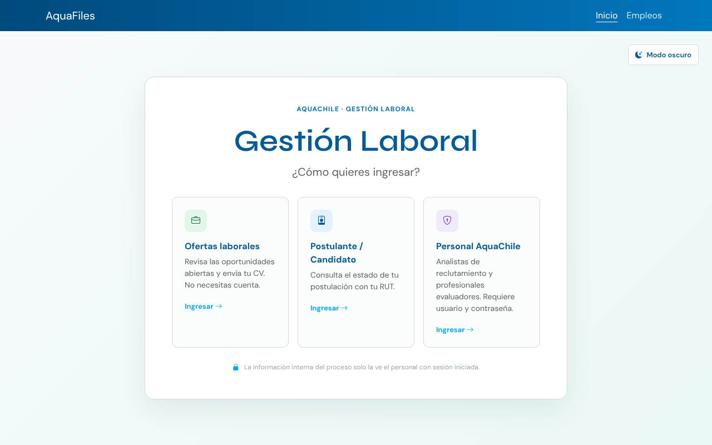

---

## 2. Portal público de empleos (postulantes)

### 2.1 Buscar ofertas

En **Ofertas laborales** (o el menú **Empleos**) aparecen solo las ofertas publicadas por AquaChile. Puedes:

- Escribir una palabra clave (por ejemplo, "técnico") y presionar **Buscar**.
- Filtrar por **categoría** con los botones (Operaciones, Producción, Personas).
- Filtrar por **modalidad** (presencial, híbrida o remota).

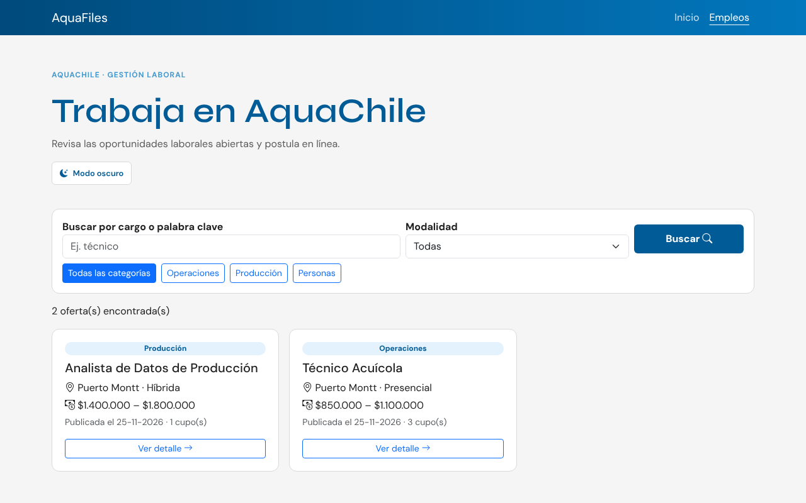

En el celular, las ofertas se muestran una debajo de otra:

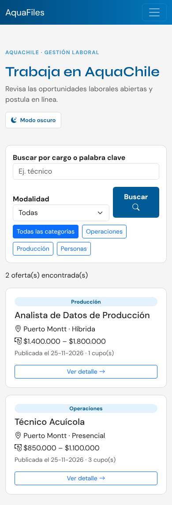

### 2.2 Ver el detalle

Presiona **Ver detalle** para ver toda la información: descripción, funciones, requisitos, beneficios, sueldo, cupos, modalidad y fecha de publicación.

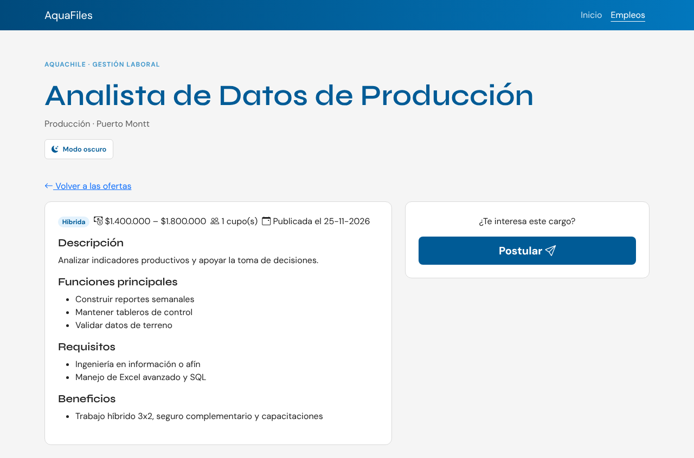

### 2.3 Postular

1. Presiona **Postular**.
2. Completa nombre, RUT, correo, teléfono y centro de costos. El cargo, la categoría y la ubicación se toman de la oferta.
3. Adjunta tu CV (**PDF o Word, máximo 5 MB**).
4. Presiona **Enviar postulación**.

Si falta un dato o está mal escrito, el formulario lo marca en rojo y no se envía:

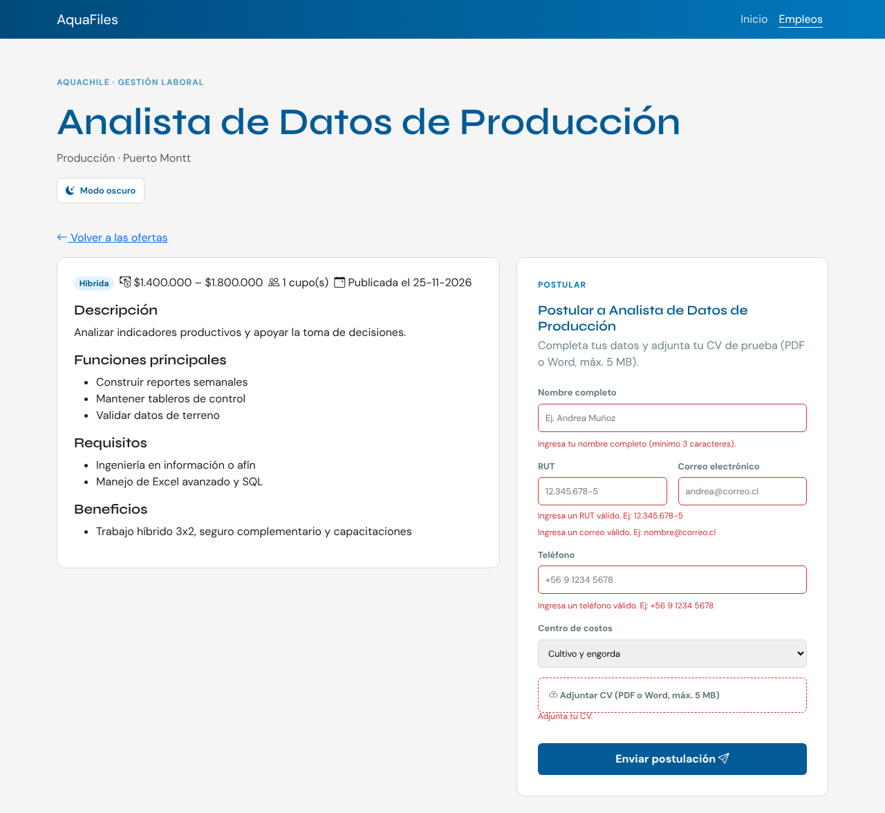

Al enviarla aparece **"¡Postulación enviada!"**. Tu CV queda guardado de forma privada; solo lo ve el personal autorizado.

> Cada RUT puede tener **una** postulación activa. Si vuelves a postular con el mismo RUT, el sistema te avisará.

---

## 3. Consultar mi postulación

1. En el inicio, elige **Postulante / Candidato**.
2. Escribe tu RUT y presiona **Consultar**.

Verás el estado general de tu proceso: **En revisión técnica → Agendado → Proceso finalizado**, y la fecha de tu entrevista cuando esté agendada.

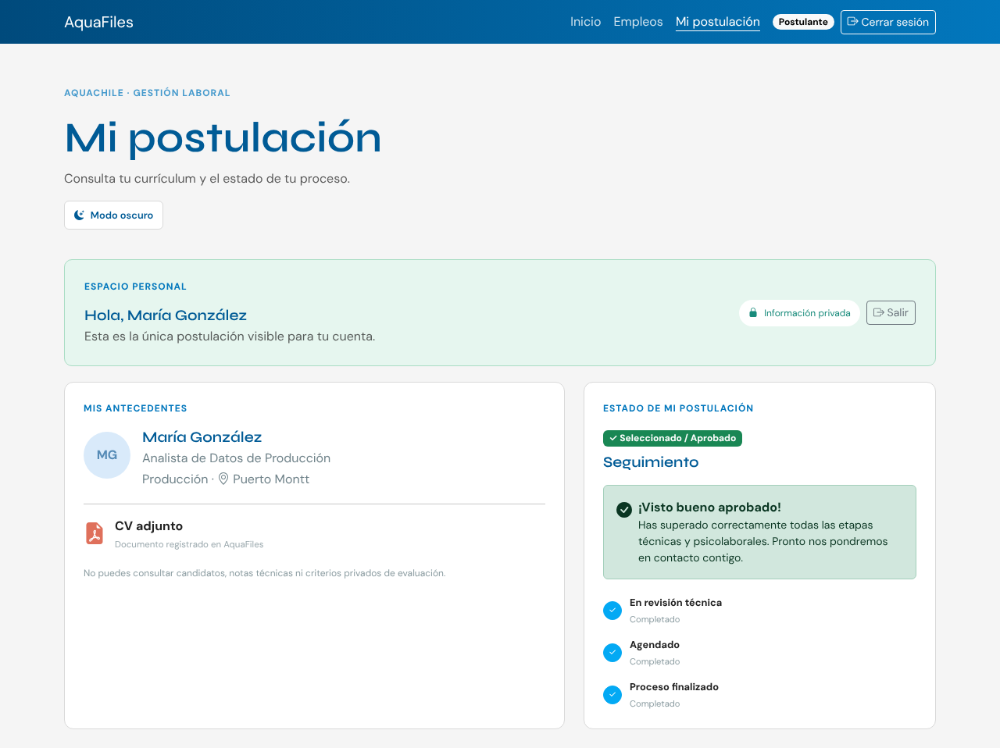

> El postulante **no** ve las observaciones internas, las decisiones técnicas ni los criterios de evaluación.

---

## 4. Inicio de sesión del personal

1. En el inicio, elige **Personal AquaChile**.
2. Escribe tu usuario y contraseña y presiona **Ingresar**.

**Usuarios de prueba (ficticios):**

| Usuario | Contraseña | Nombre | Rol |
| :--- | :--- | :--- | :--- |
| `analista` | `aqua123` | Rosa Martínez | Analista de Reclutamiento |
| `evaluador` | `aqua123` | Luis Herrera | Profesional Evaluador |
| `evaluadora` | `aqua123` | Andrea Vidal | Profesional Evaluador |

Si la contraseña es incorrecta, aparece un aviso:

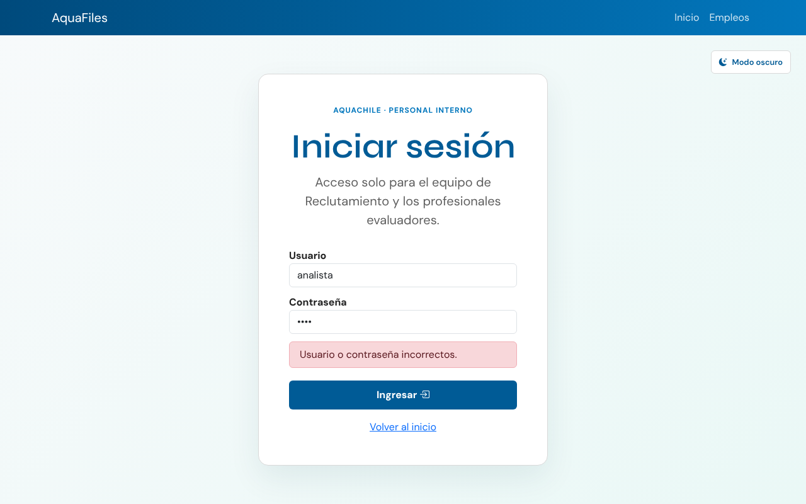

Si alguien intenta abrir una pantalla interna sin iniciar sesión (o con un rol que no corresponde), ve **"Acceso restringido"**. La misma protección existe en el servidor: aunque alguien escriba la dirección a mano, la API responde 401 o 403.

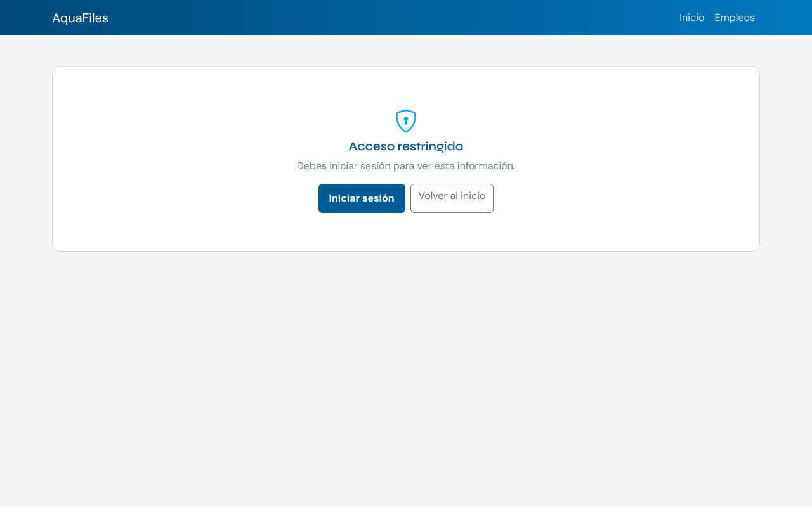

Para salir, presiona **Cerrar sesión** en el menú.

---

## 5. Analista de Reclutamiento

El menú del analista tiene **Reclutamiento**, **Ofertas** y **Dashboard**.

### 5.1 Panel de Reclutamiento

Muestra los indicadores, las postulaciones recientes y la tabla de solicitudes. Puedes buscar por nombre, RUT, cargo o ubicación, y filtrar por estado y centro de costos.

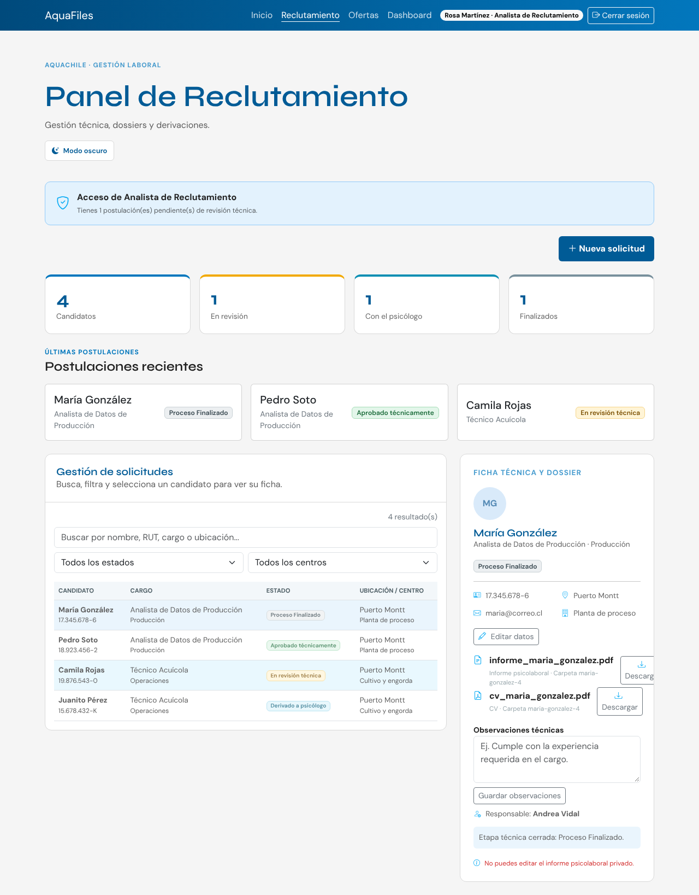

Con **+ Nueva solicitud** el analista registra a un candidato directamente (por ejemplo, una derivación interna).

### 5.2 Ficha del candidato

Al seleccionar una fila se abre la ficha del candidato. Desde ahí puedes:

- **Editar datos** (cargo, ubicación, centro de costos).
- **Descargar el CV.** Se muestra la carpeta privada donde quedó guardado (`nombre-del-postulante-ID`).
- Escribir y **guardar observaciones técnicas**. El evaluador las verá.
- **Aprobar** o **rechazar** la etapa técnica.
- **Derivar al evaluador.** Primero eliges el **profesional responsable**; el botón se habilita solo cuando hay uno seleccionado.

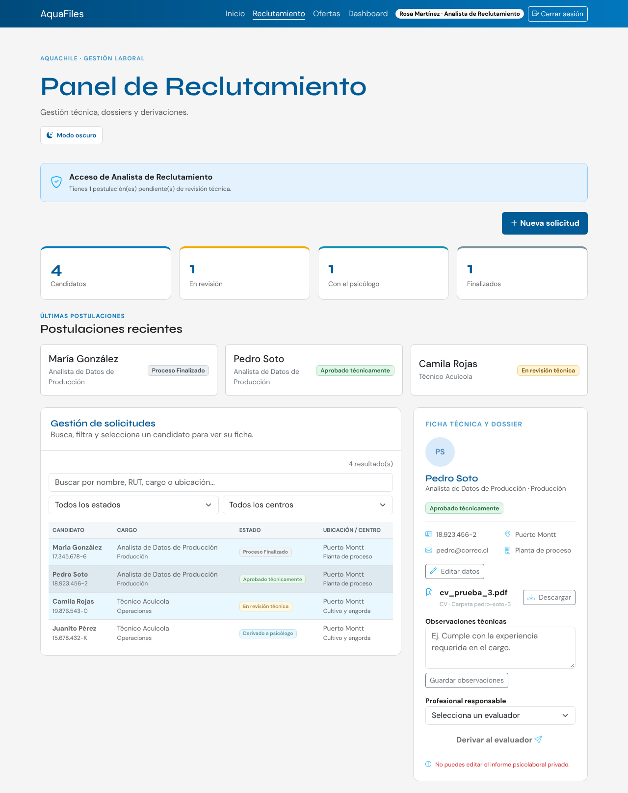

### 5.3 Ofertas laborales

En **Ofertas** se administran las ofertas del portal:

| Acción | Cómo |
| :--- | :--- |
| Crear | **+ Nueva oferta**. La oferta queda como **Borrador** |
| Editar | Ícono ✏️ |
| Publicar | **Publicar**. La oferta aparece en el portal con la fecha del día |
| Despublicar | **Despublicar**. Deja de verse en el portal, pero conserva sus postulaciones |
| Eliminar | Ícono 🗑️. Solo si la oferta no tiene postulaciones; si tiene, se debe despublicar |

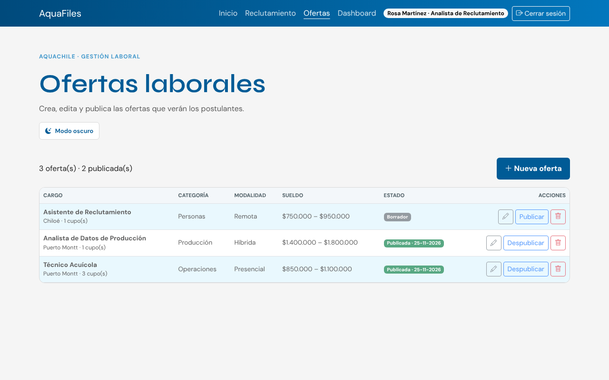

Cada oferta registra: cargo, categoría, ubicación, modalidad, cupos, sueldo mínimo y máximo, descripción, funciones, requisitos y beneficios.

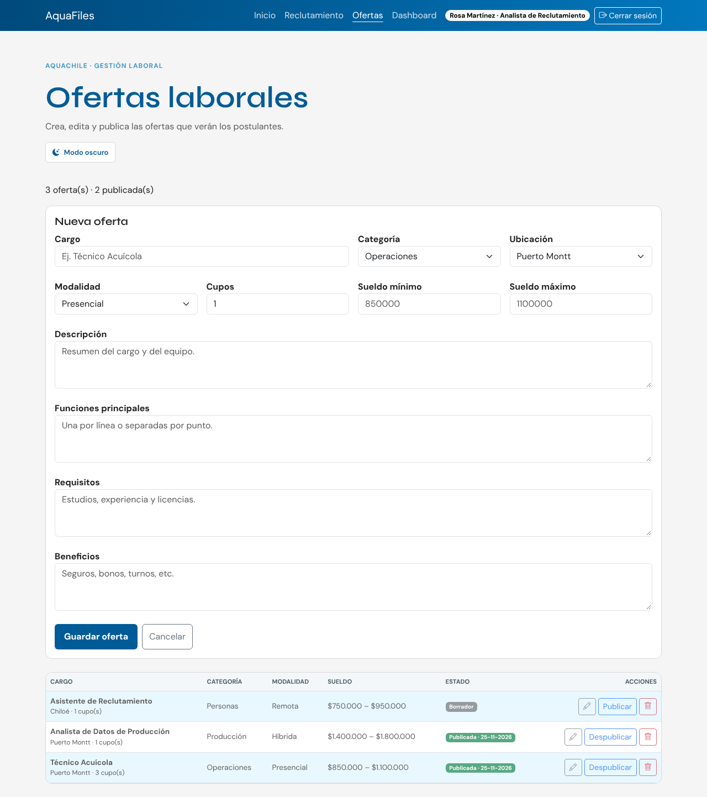

### 5.4 Dashboard

Resume el proceso con los estados de referencia **Pendiente**, **En proceso** y **Finalizada**, la cantidad por familia de cargo y por ubicación, los tiempos promedio y el responsable de cada solicitud.

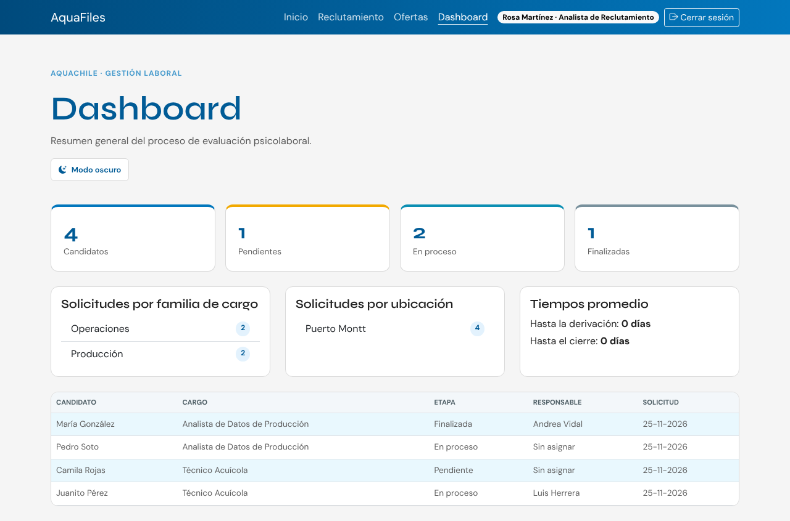

---

## 6. Profesional Evaluador

El evaluador ve **solo** los candidatos derivados. No puede modificar la calificación técnica ni eliminar candidatos.

### 6.1 Agendar la entrevista

1. Selecciona al candidato en **Candidatos derivados**.
2. Revisa su CV (botón **Descargar**) y las observaciones del analista.
3. Elige la **Fecha de entrevista**. El estado pasa a **Agendado** y el postulante verá la fecha.
4. (Opcional) En **Google Calendar y Meet**, ajusta la hora y presiona **Crear evento con Google Meet**. Google pedirá permiso a tu cuenta y creará la reunión de 30 minutos con invitación al correo del candidato.

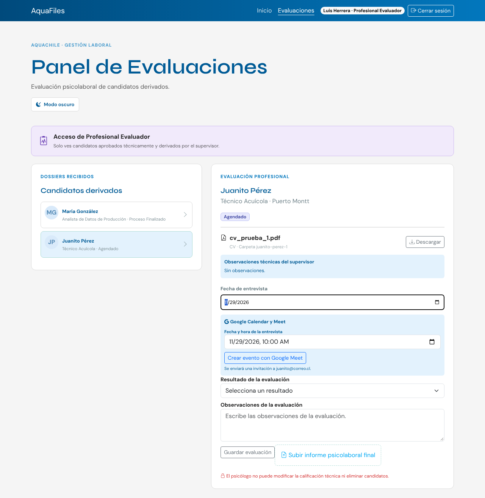

### 6.2 Registrar la evaluación y cerrar el proceso

1. Elige el **Resultado** (Recomendable, Recomendable con observaciones o No recomendable) y escribe las observaciones.
2. Presiona **Guardar evaluación**.
3. Sube el **informe psicolaboral final**. El proceso queda **Finalizado** y ya no se puede modificar.

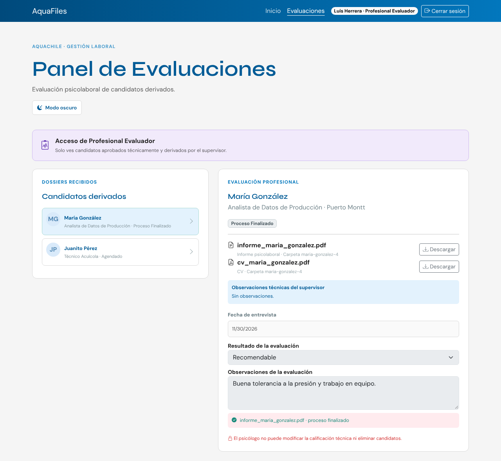

---

## 7. Preguntas frecuentes

**¿Qué archivos acepta el CV?** PDF, DOC o DOCX de hasta 5 MB.

**¿Puedo cambiar mi CV después de postular?** No desde el portal: por seguridad, cada postulación acepta un solo CV. Escribe al equipo de Reclutamiento.

**La página dice "No se pudo conectar con el servidor".** El backend está apagado o la dirección configurada en `VITE_API_URL` no es correcta (ver [Documento técnico](DOCUMENTO_TECNICO.md)).

**"Tu sesión expiró".** El token dura 60 minutos. Vuelve a iniciar sesión.

**El bloque de Google Calendar dice "no está configurado".** Falta la variable `VITE_GOOGLE_CLIENT_ID` en el frontend (ver [Documento técnico](DOCUMENTO_TECNICO.md#8-integración-con-google-calendar)).
